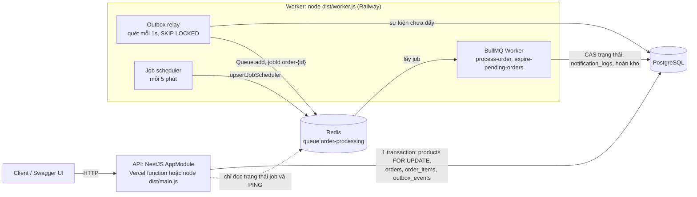
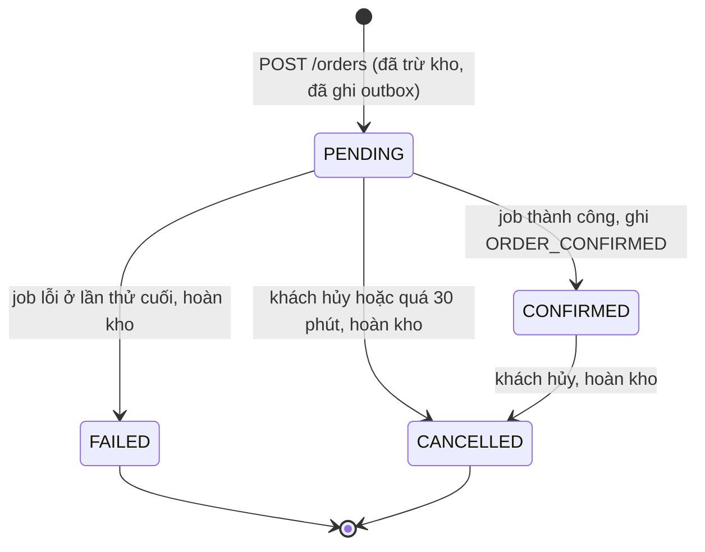
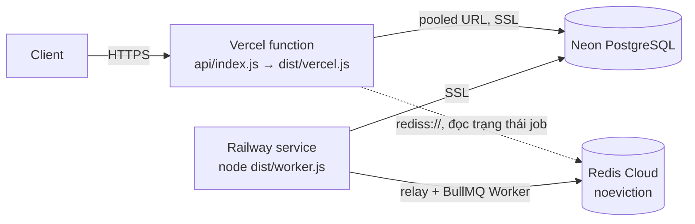

# Mini Order Management

**API:** `<API_URL>` · **Swagger:** `<SWAGGER_URL>` (`<API_URL>/api/docs`) · **Repo:** `<REPO_URL>`

> **TODO (tác giả):** điền ba link trên sau khi deploy. Repo này **chưa được deploy** (chưa có tài khoản Vercel, Railway, Neon, Redis Cloud). Cấu hình deploy đã sẵn sàng và đã được kiểm tra local, xem [Deploy worker và lý do](#deploy-worker-và-lý-do).

Backend REST quản lý **sản phẩm**, **tồn kho** và **đơn hàng** cho một cửa hàng online nhỏ: NestJS 12, PostgreSQL + TypeORM 1.x (migration, không `synchronize`), BullMQ 6 + Redis, Swagger.

Khi khách đặt hàng, API kiểm tra và trừ kho, tạo đơn `PENDING` và ghi một sự kiện outbox trong **một transaction**. Một worker riêng đẩy sự kiện thành job BullMQ, giả lập xử lý 3–5 giây với 30% lỗi ngẫu nhiên, retry kèm backoff, rồi xác nhận đơn hoặc đánh dấu thất bại và hoàn kho.

README này là bản tóm tắt. Đặc tả đầy đủ (tiếng Việt) nằm trong [`docs/`](docs/README.md): yêu cầu, kiến trúc, dữ liệu, API, luồng đơn, chống bán vượt, kiểm thử, triển khai và nhật ký quyết định (ADR).

## Mục lục

- [Tính năng chính](#tính-năng-chính)
- [Kiến trúc](#kiến-trúc)
- [Chạy local](#chạy-local)
- [Biến môi trường](#biến-môi-trường)
- [Mô tả bảng dữ liệu](#mô-tả-bảng-dữ-liệu)
- [Luồng xử lý đơn và job](#luồng-xử-lý-đơn-và-job)
- [Chống bán vượt tồn kho](#chống-bán-vượt-tồn-kho)
- [Deploy worker và lý do](#deploy-worker-và-lý-do)
- [Kiểm thử](#kiểm-thử)
- [Giả định và quyết định kỹ thuật](#giả-định-và-quyết-định-kỹ-thuật)
- [Phần chưa làm được / hướng cải tiến](#phần-chưa-làm-được--hướng-cải-tiến)

## Tính năng chính

| Method | Path | Mô tả |
|---|---|---|
| `POST` | `/products` | Tạo sản phẩm. SKU được trim và chuyển chữ in hoa, duy nhất trong các sản phẩm chưa xóa (`409 SKU_ALREADY_EXISTS`) |
| `GET` | `/products` | Phân trang (`page`, `limit ≤ 100`), tìm theo tên (`search`, `ILIKE` có escape `%`/`_`), lọc giá (`minPrice ≤ maxPrice`) |
| `GET` / `PATCH` / `DELETE` | `/products/:id` | Chi tiết, cập nhật một phần, **xóa mềm** (`deleted_at`) |
| `POST` | `/orders` | Tạo đơn trong một transaction: khóa sản phẩm (`FOR UPDATE`), kiểm tra và trừ kho, snapshot giá, ghi sự kiện outbox. Không gọi Redis |
| `GET` | `/orders` | Phân trang, lọc `status` |
| `GET` | `/orders/:id` | Đơn kèm `items` (snapshot SKU, tên, đơn giá, `lineTotal`) |
| `PATCH` | `/orders/:id/cancel` | Hủy đơn `PENDING`/`CONFIRMED` và hoàn kho trong cùng transaction |
| `GET` | `/orders/:id/jobs` | Đơn đã được đẩy sang queue chưa (`dispatch`, từ outbox) và trạng thái job BullMQ (`state`, `attemptsMade`, `failedReason`, …) |
| `GET` | `/health` | `SELECT 1` và `PING` Redis, `200` hoặc `503` |
| `GET` | `/api/docs`, `/api/docs-json` | Swagger UI và OpenAPI JSON |

Xử lý nền (worker):

- **Outbox relay** đẩy sự kiện `ORDER_CREATED` thành job `process-order` (`jobId = order-{orderId}`).
- **Job `process-order`:** giả lập 3–5s, lỗi ngẫu nhiên 30%, `attempts = 4` (lần đầu và 3 retry, backoff 2s → 4s → 8s). Thành công: `CONFIRMED` và ghi `notification_logs`. Lỗi ở lần cuối: `FAILED` và hoàn kho.
- **Job scheduler `expire-pending-orders`** mỗi 5 phút: hủy đơn `PENDING` quá 30 phút (`cancelReason = EXPIRED`) và hoàn kho.

Chung: định dạng lỗi thống nhất `{ statusCode, error, message, details?, path, timestamp }` với mã lỗi máy đọc được ([docs/04 §2, §5](docs/04-api-spec.md#2-định-dạng-lỗi-thống-nhất)), validate DTO toàn cục (field lạ bị từ chối), validate biến môi trường lúc khởi động, tiền là số nguyên VND.

## Kiến trúc

Hai tiến trình, một codebase ([docs/02](docs/02-architecture.md)):



| | API (`AppModule`) | Worker (`WorkerModule`) |
|---|---|---|
| Entry | `src/main.ts` (local), `src/vercel.ts` → `api/index.js` (Vercel) | `src/worker.ts` (application context, không mở cổng HTTP) |
| PostgreSQL | Mọi nghiệp vụ đồng bộ, ghi `outbox_events` trong transaction tạo đơn | Đọc outbox, xác nhận / thất bại / hết hạn đơn |
| Redis | Chỉ đọc trạng thái job (`GET /orders/:id/jobs`) và `PING` (`/health`), `enableOfflineQueue: false` | `Queue.add` (relay), BullMQ `Worker`, job scheduler, `maxRetriesPerRequest: null` |

`AppModule` **không** import processor hay relay: nếu import, function serverless sẽ tự khởi tạo BullMQ `Worker` và vòng quét outbox, rồi bị đóng băng sau mỗi response.

Cấu trúc thư mục chính: `src/products`, `src/orders`, `src/outbox`, `src/queue` (queue, producer, processor, scheduler), `src/notifications`, `src/health`, `src/common` (lỗi, filter, pipe, DTO dùng chung), `src/config`, `src/database` (DataSource, migration), `src/scripts` (lệnh dev), `test/` (e2e). Chi tiết ở [docs/02 §4](docs/02-architecture.md#4-cấu-trúc-thư-mục).

## Chạy local

**Yêu cầu:** Node.js 22 (≥ 22.13, khuyến nghị **≥ 22.22.3** để không thấy cảnh báo `EBADENGINE` của các gói dev-only của Nest CLI), npm, Docker Desktop. `engines.node` là `^22.13`: Node 24 vẫn chạy được nhưng `npm ci` in cảnh báo cho chính dự án ([docs/08 §2.1](docs/08-deployment.md#21-yêu-cầu)).

```bash
docker compose up -d          # PostgreSQL 16 (DB mini_oms và mini_oms_test) + Redis 7 (noeviction)
cp .env.example .env          # PowerShell: Copy-Item .env.example .env
npm ci
npm run migration:run
npm run start:dev             # API: http://localhost:3000, Swagger: http://localhost:3000/api/docs
npm run start:worker:dev      # terminal thứ hai, sau khi lệnh trên in "Found 0 errors"
```

> `start:dev` và `start:worker:dev` cùng biên dịch vào `dist/` và mỗi lệnh xóa `dist/` khi bắt đầu, nên hãy chạy lần lượt. Chạy giống production: `npm run build`, rồi `npm run start:prod` và `npm run start:worker:prod`.

Thử nhanh (bash):

```bash
curl -s localhost:3000/health
curl -s -X POST localhost:3000/products -H 'content-type: application/json' \
  -d '{"sku":"tshirt-white-m","name":"White T-shirt size M","price":199000,"stock":5}'
curl -s -X POST localhost:3000/orders -H 'content-type: application/json' \
  -d '{"customerName":"Nguyen Van A","customerEmail":"a@example.com","items":[{"productId":"<productId>","quantity":2}]}'
# khoảng 5–8 giây sau (relay ≤ 1s + xử lý 3–5s, lâu hơn nếu bị retry):
curl -s localhost:3000/orders/<orderId>          # CONFIRMED
curl -s localhost:3000/orders/<orderId>/jobs     # dispatch PUBLISHED, job completed
```

Lệnh hỗ trợ:

| Lệnh | Mô tả |
|---|---|
| `npm run migration:show` / `migration:revert` | Xem / lùi migration |
| `npm run job:expire-now` | Chạy job hủy đơn quá hạn một lần (không cần worker) |
| `npm run job:requeue -- <orderId>` | Xóa rồi đẩy lại job của một đơn (kiểm tra idempotency) |
| `npm run race:last-item -- [baseUrl] [N]` | N đơn đồng thời cho một sản phẩm `stock = 1` trên API đang chạy ([chống bán vượt](#chống-bán-vượt-tồn-kho)) |

## Biến môi trường

Danh sách đầy đủ, giá trị mặc định và quy tắc validate: [docs/02 §7](docs/02-architecture.md#7-cấu-hình-biến-môi-trường) và [`.env.example`](.env.example). Env được validate lúc khởi động: sai hoặc thiếu thì tiến trình dừng ngay và liệt kê mọi biến sai. Biến môi trường thật luôn được ưu tiên hơn file `.env`.

| Biến | Mặc định | Dùng ở | Ý nghĩa |
|---|---|---|---|
| `DATABASE_URL` | *(bắt buộc)* | API, worker, CLI | `postgres://…`. Production: pooled URL của Neon cho API |
| `DATABASE_SSL` / `DATABASE_POOL_MAX` | `false` / `10` | API, worker | Bật SSL cho Neon. Pool nhỏ (3) trên Vercel |
| `DB_LOCK_TIMEOUT_MS` | `5000` | API | `lock_timeout` của transaction tạo/hủy đơn, quá thì `503` |
| `REDIS_URL` | *(bắt buộc)* | API, worker | `redis://` hoặc `rediss://` (TLS), có thể kèm số DB (`/2`) |
| `JOB_ATTEMPTS` / `JOB_BACKOFF_DELAY_MS` | `4` / `2000` | Worker | Tổng số lần chạy job (1 + 3 retry), delay gốc của backoff exponential |
| `JOB_PROCESSING_MIN_MS` / `JOB_PROCESSING_MAX_MS` | `3000` / `5000` | Worker | Thời gian xử lý giả lập |
| `JOB_FAILURE_RATE` | `0.3` | Worker | Xác suất lỗi giả lập (`0..1`) |
| `WORKER_CONCURRENCY` | `5` | Worker | Số job xử lý song song |
| `OUTBOX_POLL_INTERVAL_MS` / `OUTBOX_BATCH_SIZE` / `OUTBOX_MAX_BACKOFF_MS` | `1000` / `50` / `30000` | Worker | Chu kỳ quét outbox, cỡ lô, chu kỳ tối đa khi Redis lỗi |
| `ORDER_PENDING_TTL_MINUTES` / `EXPIRE_PENDING_EVERY_MS` / `EXPIRE_BATCH_SIZE` | `30` / `300000` / `100` | Worker | Job hủy đơn quá hạn |
| `JOB_KEEP_COMPLETED_SECONDS` / `JOB_KEEP_FAILED_SECONDS` | 7 / 14 ngày | Worker | Thời gian giữ job đã xong trong Redis |
| `SWAGGER_ENABLED`, `PORT`, `DATABASE_LOGGING` | `true`, `3000`, `false` | API | |
| `NODE_ENV` | `development` | | Chỉ được validate (`development` / `test` / `production`), code không đọc. Không cần đặt khi deploy |

`.env.test` (được commit, chỉ chứa giá trị mặc định của docker-compose) là env của test e2e: DB `mini_oms_test`, pool 40 connection.

## Mô tả bảng dữ liệu

ERD, đặc tả từng cột và DDL tham chiếu: [docs/03](docs/03-database.md). Schema chỉ thay đổi qua 4 migration trong `src/database/migrations/` (`CreateProducts`, `CreateOrders`, `CreateOutboxEvents`, `CreateNotificationLogs`), có `up` và `down`.

| Bảng | Vai trò | Cột và ràng buộc chính |
|---|---|---|
| `products` | Danh mục và tồn kho | `id uuid`, `sku varchar(64)`, `name`, `price bigint` (VND), `stock integer`, `deleted_at` (xóa mềm). `chk_products_stock_non_negative` (`stock >= 0`, lớp chặn cuối chống bán vượt), `chk_products_price_non_negative`, `uq_products_sku_active` (unique `sku` **chỉ trên dòng chưa xóa**, nên SKU dùng lại được sau khi xóa), index danh sách và lọc giá |
| `orders` | Đơn hàng | `status order_status` (`PENDING`, `CONFIRMED`, `FAILED`, `CANCELLED`), `total_amount bigint` (lưu cố định), `cancel_reason` (`CUSTOMER_REQUEST` / `EXPIRED`), `failure_reason`, `confirmed_at` / `cancelled_at` / `failed_at`, `created_at` (dùng để tính hết hạn). `idx_orders_status_created_at` phục vụ lọc theo trạng thái và job hết hạn |
| `order_items` | Dòng của đơn | **Snapshot** `product_sku`, `product_name`, `unit_price` lúc đặt (đổi giá hay xóa sản phẩm không ảnh hưởng đơn cũ). `quantity > 0`. FK tới `orders` (`CASCADE`) và `products` (`RESTRICT`). `uq_order_items_order_product`: một sản phẩm một dòng mỗi đơn |
| `notification_logs` | Thông báo "đã gửi" (thay cho email thật) | `type` (`ORDER_CONFIRMED`), `channel`, `recipient`, `subject`, `payload jsonb`. `uq_notification_logs_order_type` `UNIQUE(order_id, type)`: DB bảo đảm không có thông báo trùng |
| `outbox_events` | Transactional Outbox | `id bigint identity` (relay quét theo thứ tự ghi), `aggregate_id uuid` (id đơn, không FK), `event_type`, `payload jsonb`, `published_at` (`NULL` = chưa đẩy), `publish_attempts`, `last_error`. `uq_outbox_events_aggregate_event` (mỗi đơn một `ORDER_CREATED`), partial index `idx_outbox_events_unpublished` |

Quy ước: khóa chính UUID `gen_random_uuid()` (riêng outbox dùng `bigint identity`), thời gian `timestamptz`, tiền `bigint` VND và API nhận/trả số nguyên ([ADR-007](docs/10-technical-decisions.md#adr-007-kiểu-dữ-liệu-tiền)), tên ràng buộc có tiền tố `pk_`/`fk_`/`uq_`/`idx_`/`chk_` để exception filter ánh xạ lỗi Postgres sang mã lỗi API (ví dụ `23505` trên `uq_products_sku_active` → `409 SKU_ALREADY_EXISTS`).

## Luồng xử lý đơn và job

Chi tiết: [docs/05](docs/05-order-processing.md).

### Máy trạng thái



Mọi chuyển trạng thái là một **CAS**: `UPDATE orders SET status = $to … WHERE id = $id AND status = ANY($from) RETURNING …`. Tác dụng phụ (hoàn kho, ghi thông báo) chỉ chạy khi CAS trả về một dòng, **trong cùng transaction**. `FAILED` và `CANCELLED` là trạng thái cuối, nên mỗi đơn được hoàn kho tối đa một lần.

### Tạo đơn và Transactional Outbox

1. **API, một transaction:** khóa sản phẩm (`SELECT … ORDER BY id FOR UPDATE`), kiểm tra tồn tại (`404`) và tồn kho (`409`, liệt kê **mọi** item thiếu), `stock = stock - q`, insert `orders` + `order_items` (snapshot), insert `outbox_events` (`ORDER_CREATED`). Trả `201` với đơn `PENDING`. **Không gọi Redis.**
2. **Relay trong worker**, mỗi `OUTBOX_POLL_INTERVAL_MS` (1s): `SELECT … FROM outbox_events WHERE published_at IS NULL ORDER BY id LIMIT 50 FOR UPDATE SKIP LOCKED`, gọi `Queue.add('process-order', { orderId }, { jobId: 'order-{orderId}' })` rồi đặt `published_at`. Redis lỗi thì tăng `publish_attempts`, ghi `last_error`, dừng lô và giãn chu kỳ quét (2s, 4s, … tối đa 30s).

Vì sao outbox ([ADR-003](docs/10-technical-decisions.md#adr-003-đẩy-job-qua-transactional-outbox)): đẩy job **trong** transaction thì worker có thể đọc đơn chưa commit, đẩy **sau** commit thì Redis lỗi đúng lúc đó sẽ làm mất job. Outbox ghi đơn và sự kiện nguyên tử, relay đẩy lại cho tới khi thành công (at-least-once). `jobId` cố định khiến lần đẩy trùng là no-op. Id đơn lấy từ cột `aggregate_id` (`uuid NOT NULL`), không từ `payload`, để không có sự kiện "độc" nào chặn hàng đợi.

### Job `process-order` và chính sách retry

> **Cách hiểu đề "retry tối đa 3 lần":** hiểu theo nghĩa đen là **3 lần thử lại sau lần chạy đầu**, tức `attempts = 4` (1 lần đầu + 3 retry), backoff exponential `2000 × 2^(n−1)`: chờ **2s, 4s, 8s** giữa các lần. Trường hợp xấu nhất mất khoảng `4 × 5s + (2 + 4 + 8)s ≈ 34s` (chưa tính ≤ 1s của relay). Với tỉ lệ lỗi 30%, xác suất đơn `FAILED` là `0.3⁴ ≈ 0.81%`. Nếu người chấm hiểu là tổng cộng 3 lần chạy, chỉ cần đặt `JOB_ATTEMPTS=3` ([ADR-001](docs/10-technical-decisions.md#adr-001-số-lần-chạy-job-và-backoff)).

| Lần chạy | Bắt đầu | Nếu lỗi |
|---|---|---|
| 1 | ≤ 1s sau khi tạo đơn | `delayed`, chờ 2s |
| 2 (retry 1) | +2s | `delayed`, chờ 4s |
| 3 (retry 2) | +4s | `delayed`, chờ 8s |
| 4 (retry 3, cuối) | +8s | `failOrder()`: `FAILED`, ghi `failureReason`, hoàn kho. Job vào `failed` |

Mỗi lần chạy: đọc trạng thái đơn (không còn `PENDING` thì kết thúc `{ skipped: true }`, không tìm thấy đơn thì `UnrecoverableError`, không retry), sleep 3–5s, lỗi giả lập 30%, rồi `confirmOrder()`: CAS `PENDING → CONFIRMED` và `INSERT notification_logs … ON CONFLICT DO NOTHING` trong một transaction.

**Bù trừ ở lần thử cuối** nằm ngay trong processor (`attemptsMade + 1 >= attempts`, đã đối chiếu với mã nguồn BullMQ 6.3), không dùng event `failed` của worker: handler của event không được `await` và chạy sau khi job đã `failed`, tiến trình chết đúng lúc đó sẽ làm mất bước hoàn kho ([ADR-017](docs/10-technical-decisions.md#adr-017-bù-trừ-ở-lần-thử-cuối)). Lỗi ở bất kỳ bước nào của lần cuối (kể cả đọc trạng thái) đều dẫn tới `failOrder`. Nếu chính `failOrder` lỗi, job hết hạn là lưới an toàn.

### Idempotency: bốn lớp

| Lớp | Cơ chế | Chặn được |
|---|---|---|
| L1, queue | `jobId = order-{orderId}`: BullMQ bỏ qua `add` trùng id | Relay đẩy lại cùng một sự kiện |
| L2, processor | Đọc trạng thái trước, không còn `PENDING` thì `skipped` | Job chạy lại sau khi đã xử lý, job bị thêm lại sau khi đã dọn |
| L3, DB (CAS) | `UPDATE … WHERE status = ANY($from)`, tác dụng phụ chỉ khi CAS thành công | Race giữa kiểm tra và cập nhật, hai worker cùng chạy một job, khách hủy trong lúc job đang sleep |
| L4, ràng buộc | `UNIQUE(order_id, type)`, `UNIQUE(aggregate_id, event_type)`, `CHECK (stock >= 0)` | Trùng thông báo, trùng sự kiện, âm kho nếu logic phía trên có lỗi |

### Hủy đơn

`PATCH /orders/:id/cancel`: CAS `PENDING | CONFIRMED → CANCELLED` (`CUSTOMER_REQUEST`) rồi hoàn kho theo thứ tự `product_id`, trong một transaction. CAS không khớp thì một truy vấn phụ phân biệt `404 ORDER_NOT_FOUND` và `409 INVALID_ORDER_STATUS`. Hủy trước khi relay kịp đẩy job vẫn đúng: job sau đó thấy `CANCELLED` và bỏ qua.

### Job hủy đơn quá hạn

`upsertJobScheduler('expire-pending-orders', { every: 300000 })` khi worker khởi động (id cố định, khởi động lại không nhân đôi). Mỗi lần chạy lấy tối đa 100 đơn `PENDING` có `created_at < now() - 30 phút` (đồng hồ của DB), mỗi đơn **một transaction**: CAS `PENDING → CANCELLED` với `cancel_reason = EXPIRED`, rồi hoàn kho. Lỗi ở một đơn chỉ rollback đơn đó. `npm run job:expire-now` chạy job này một lần.

### Khi hạ tầng lỗi

| Sự cố | Hệ quả |
|---|---|
| Redis chết khi tạo đơn | Không ảnh hưởng: `POST /orders` vẫn `201`, sự kiện chờ trong outbox và được đẩy khi Redis sống lại (IT-05). Hồi phục mất hàng chục giây: ioredis của worker thử kết nối lại tối đa mỗi 20s, relay quét lại sau tối đa `OUTBOX_MAX_BACKOFF_MS` (30s), nên đơn `CONFIRMED` sau tối đa khoảng 20s cộng thời gian xử lý, còn `published_at` có thể muộn tới khoảng 55s ([docs/05 §11](docs/05-order-processing.md#11-các-chế-độ-lỗi-hạ-tầng)) |
| Redis chết khi gọi `GET /orders/:id/jobs` | `503 SERVICE_UNAVAILABLE` ngay (hoặc sau tối đa 3s) |
| Worker không chạy | Đơn nằm `PENDING`, relay đẩy job khi worker chạy lại. Quá 30 phút thì bị hủy (`EXPIRED`), job của nó sau đó bị bỏ qua |
| Deploy hoặc restart worker (SIGTERM) | Relay dừng sau lô hiện tại, `worker.close()` chờ job đang chạy, quá 10s thì `exit(1)` |

## Chống bán vượt tồn kho

Chi tiết: [docs/06](docs/06-concurrency.md), [ADR-002](docs/10-technical-decisions.md#adr-002-chống-bán-vượt-tồn-kho).

```sql
BEGIN;                                                   -- READ COMMITTED (mặc định)
SELECT set_config('lock_timeout', '5000ms', true);       -- = SET LOCAL lock_timeout
SELECT id, sku, name, price, stock FROM products
 WHERE id IN ($1, $2) AND deleted_at IS NULL
 ORDER BY id
   FOR UPDATE;                                           -- khóa mọi sản phẩm của đơn trong MỘT câu
-- app: thiếu sản phẩm -> 404, thiếu hàng -> 409 (liệt kê mọi item), ROLLBACK
UPDATE products SET stock = stock - $q1 WHERE id = $1;   -- tương đối, không ghi giá trị tính sẵn
UPDATE products SET stock = stock - $q2 WHERE id = $2;
INSERT INTO orders …; INSERT INTO order_items …; INSERT INTO outbox_events …;
COMMIT;
```

| Lớp | Cơ chế | Vai trò |
|---|---|---|
| 1 | `SELECT … FOR UPDATE` và kiểm tra trong `OrdersService` | Quyết định nghiệp vụ. Request đến sau phải chờ, rồi đọc lại tồn kho **mới nhất** (ở `READ COMMITTED`, Postgres đánh giá lại dòng sau khi chờ khóa) |
| 2 | `stock = stock - q` | Không mất cập nhật kể cả khi lớp 1 có lỗi |
| 3 | `CHECK (stock >= 0)` | DB từ chối mọi trạng thái âm (`23514` → `409 INSUFFICIENT_STOCK`) |
| 4 | Một transaction | Không thể trừ kho mà không có đơn và sự kiện, hoặc ngược lại |

- **Chống deadlock:** mọi luồng khóa `products` theo `id` tăng dần (`ORDER BY id` khi tạo đơn, `ORDER BY product_id` khi hoàn kho). Luồng nào chạm cả `orders` và `products` thì khóa `orders` trước.
- **Không treo:** `lock_timeout` (`DB_LOCK_TIMEOUT_MS`) → `55P03`, deadlock bất ngờ → `40P01`, cả hai trả `503 SERVICE_UNAVAILABLE` (`The database is busy, please retry`).
- Mutex trong bộ nhớ Node không dùng được vì API chạy nhiều instance. Khóa nằm trong DB, nên đúng với bất kỳ số instance nào.

**Kết quả kiểm chứng** (Postgres thật, các request gửi cùng lúc, mỗi request một connection riêng):

| Test | Kịch bản | Kết quả |
|---|---|---|
| IT-01 | `stock = 1`, 20 đơn đồng thời | Đúng 1 × `201`, 19 × `409` (cả 19 đều do bước kiểm tra dưới khóa, `available: 0`), `stock = 0`, 1 đơn trong DB |
| IT-01b | Như IT-01 | Đúng 1 sự kiện outbox, của đơn được tạo |
| IT-02 | `stock = 10`, 30 đơn, `quantity` ngẫu nhiên 1–3 | Chỉ `201`/`409`, `Σ` đã bán `≤ 10`, `stock_cuối = 10 − Σ`, mọi đơn bị từ chối đều xin nhiều hơn phần còn lại |
| IT-02b | 40 đơn xen kẽ `[P1, P2]` / `[P2, P1]` | 40 × `201`, không có `503`/deadlock, mỗi `stock` giảm đúng 40 |
| IT-03 | 5 lệnh hủy đồng thời một đơn `quantity = 3` | 1 × `200`, 4 × `409 INVALID_ORDER_STATUS`, kho được hoàn đúng 3 |
| Script | `npm run race:last-item` (20 và 50 đơn, API `node dist/main.js`) | 1 × `201`, 19 (49) × `409`, `stock = 0` |

**Bỏ khóa thì sao?** Đã thử trên một DB tạm, thay đổi không commit ([docs/06 §9.2](docs/06-concurrency.md#92-thí-nghiệm-bỏ-khóa)):

| Cấu hình | 20 đơn đồng thời cho `stock = 1` |
|---|---|
| Bỏ `.setLock('pessimistic_write')` | Vẫn 1 × `201`, nhưng 10–19 lệnh từ chối đến từ `CHECK` của DB (`409` không có `details`): nhiều request cùng đọc `stock = 1`, cùng qua bước kiểm tra, rồi `UPDATE` của chúng bị `CHECK` chặn |
| Bỏ khóa **và** bỏ `CHECK` | **Bán vượt:** 20 × `201`, `stock = -19` |

## Deploy worker và lý do

Chi tiết: [docs/08](docs/08-deployment.md). **Trạng thái:** chưa deploy (TODO của tác giả, xem đầu README). Cấu hình đã có trong repo và handler Vercel đã được chạy thử local.



### API trên Vercel

- `nest build` (tsc) biên dịch ra `dist/`, function `api/index.js` chỉ `require('../dist/vercel').default`. Không dùng bundler esbuild của Vercel vì DI của Nest cần metadata của decorator mà tsc sinh ra ([ADR-025](docs/10-technical-decisions.md#adr-025-cách-deploy-nestjs-lên-vercel)).
- `src/vercel.ts` dùng chung `configureApp()` với `main.ts`, tạo Nest app **một lần mỗi instance**, không bao giờ `listen()`. Khởi động lỗi thì trả `503` và request sau thử lại (lỗi không bị cache). Kết nối DB khi khởi động: tối đa 3 lần, mỗi lần tối đa 5s, cách nhau 2s, nên `503` đến trong `maxDuration` 30s kể cả khi DB không trả lời. Queue (kết nối Redis) chỉ được tạo sau khi DB đã kết nối, nên lần khởi động lỗi vì DB không để lại kết nối Redis nào ([docs/08 §4.3](docs/08-deployment.md#43-lưu-ý-khi-chạy-nestjs-trên-vercel)).
- `vercel.json`: `installCommand: npm ci --include=dev` (`nest build` cần Nest CLI và TypeScript, là `devDependencies`, mà npm bỏ qua khi `NODE_ENV=production` có mặt lúc cài), `buildCommand: npm run build`, function `api/index.js` với `includeFiles: dist/**` (TypeORM nạp entity và migration theo glob) và `maxDuration: 30`, rewrite mọi path về `/api`. `public/.gitkeep` là thư mục output mà preset "Other" yêu cầu.
- **Node 22.x:** `dist/` là CommonJS và `require()` các gói `@nestjs/*` 12 (chỉ có ES module), cần Node ≥ 22.12. Vercel chọn major theo `engines.node`, map `>=22.13` sang 24.x, nên `engines.node` là `^22.13` để production chạy cùng major với môi trường đã test.
- Swagger UI lấy asset từ cdnjs (Vercel không phục vụ được file tĩnh trong `node_modules`).
- Env: `DATABASE_URL` (**pooled** URL của Neon), `DATABASE_SSL=true`, `DATABASE_POOL_MAX=3`, `REDIS_URL` (`rediss://`), `DB_LOCK_TIMEOUT_MS`, `SWAGGER_ENABLED=true`. Không cần `NODE_ENV`: code không đọc biến này.

### Worker trên Railway, và vì sao không chạy trên Vercel

Function serverless không giữ được worker:

1. Function chỉ sống trong lúc xử lý request, sau đó bị đóng băng. BullMQ `Worker` cần vòng lặp chạy liên tục và kết nối Redis blocking để chờ job.
2. Worker phải gia hạn lock của job định kỳ. Function bị đóng băng thì lock hết hạn, job bị coi là stalled và chạy lại.
3. Backoff 2s/4s/8s và scheduler 5 phút cần một tiến trình đang chạy để đưa job đến hạn vào hàng đợi.
4. Relay outbox phải quét mỗi giây, function không có vòng lặp nền.
5. Mỗi job mất 3–5s cộng retry, instance tự co giãn có thể bị hủy giữa chừng.

Vì vậy API chỉ ghi đơn và sự kiện outbox, còn relay và consumer chạy trong `node dist/worker.js`. Chọn **Railway** ([ADR-005](docs/10-technical-decisions.md#adr-005-nơi-chạy-worker)): deploy thẳng từ GitHub, có **pre-deploy command** để chạy migration ở đúng một nơi, không cần mở cổng. Render Background Worker là gói trả phí, Web Service free của Render ngủ khi không có traffic. Phương án cron gọi endpoint serverless bị loại vì backoff không đúng giờ và phải tự quản lý lock job.

Cấu hình Railway: build `npm ci --include=dev && npm run build`, start `npm run start:worker:prod`, pre-deploy `npm run migration:run:prod`, 1 replica, restart On failure, không public domain, env như [docs/08 §5.3](docs/08-deployment.md#53-railway-các-bước). Scale nhiều replica vẫn an toàn nhờ `SKIP LOCKED` và lock job của BullMQ.

### PostgreSQL, Redis và thứ tự deploy

- **Neon:** API dùng **pooled** connection string (PgBouncer, hợp với nhiều kết nối ngắn của serverless), migration dùng **direct** connection string.
- **Redis Cloud** (free): bắt buộc `maxmemory-policy noeviction` (Redis tự xóa key thì job biến mất không báo lỗi) và `rediss://`. Không chọn Upstash vì worker BullMQ gửi lệnh liên tục kể cả khi rảnh, dễ vượt hạn mức lệnh của gói free.
- **Thứ tự:** migration → worker → API. Migration không bao giờ chạy khi cold start (`synchronize: false`, `migrationsRun: false`).
- Smoke test sau deploy: [docs/08 §7](docs/08-deployment.md#7-smoke-test-sau-khi-deploy) (`/health`, tạo sản phẩm và đơn, chờ `CONFIRMED`, `/orders/:id/jobs`).

## Kiểm thử

| Lệnh | Nội dung |
|---|---|
| `npm test` | Unit test (Jest, không cần DB/Redis): các file `*.spec.ts` nằm cạnh code trong `src/` |
| `npm run test:cov` | Unit test kèm coverage |
| `npm run test:e2e` | Integration và đồng thời trên Postgres/Redis thật, cần `docker compose up -d`: 3 file trong `test/`, chạy tuần tự (`--runInBand`). DB `mini_oms_test` tự được tạo nếu thiếu, migration chạy trong `globalSetup` |
| `npm run lint`, `npm run typecheck` | ESLint (type-checked), `tsc --noEmit` |

**Unit test** ([docs/07 §2–4](docs/07-testing.md#2-unit-test-bắt-buộc-cho-ordersservice)): UT-01..UT-12 đều có.

| Mã | Nội dung | File |
|---|---|---|
| UT-01..UT-05 | Tạo đơn (trừ kho, snapshot, outbox cùng transaction, không gọi Redis), thiếu hàng, hủy và hoàn kho, hủy sai trạng thái / không tồn tại, thiếu sản phẩm | `src/orders/orders.service.spec.ts` |
| UT-06, UT-10 | `confirmOrder`/`failOrder` khi CAS thua, hủy đơn quá hạn mỗi đơn một transaction | `src/orders/orders.service.spec.ts` |
| UT-07..UT-09 | Processor: bỏ qua đơn không còn `PENDING`, bù trừ ở lần thử cuối, ném lại lỗi ở các lần trước | `src/queue/order-processing.processor.spec.ts` |
| UT-11, UT-12 | Relay: đẩy cả lô, dừng lô ở sự kiện Redis từ chối | `src/outbox/outbox-relay.service.spec.ts` |

Ngoài ra: validate DTO qua đúng `ValidationPipe` production, `:id` được chuẩn hóa thành chữ thường, exception filter (ánh xạ lỗi Postgres), validate env, tài liệu Swagger, producer và kết nối Redis, scheduler, `/health`, handler Vercel.

**Integration / đồng thời** ([docs/07 §5](docs/07-testing.md#5-integration-test-và-test-đồng-thời)): IT-01, IT-01b, IT-02, IT-02b, IT-03 (`test/concurrency.e2e-spec.ts`), IT-04 (đẩy một đơn 3 lần vẫn 1 job), IT-05 (đơn tạo lúc Redis chết được đẩy khi Redis sống lại) (`test/outbox-relay.e2e-spec.ts`), `/health` `200` và `503` (`test/health.e2e-spec.ts`). Kết quả ở mục [Chống bán vượt tồn kho](#chống-bán-vượt-tồn-kho).

**Thủ công** ([docs/07 §6](docs/07-testing.md#6-kịch-bản-test-thủ-công)): MT-01..MT-11 (CRUD sản phẩm, lọc, đơn `PENDING → CONFIRMED`, `JOB_FAILURE_RATE=1` → `FAILED` sau 4 lần chạy, retry 2s/4s/8s, hủy, requeue, đơn hết hạn, Redis tắt khi tạo đơn, kiểm tra trên bản deploy). MT-10 cần bản deploy nên chưa làm.

Smoke test local khi hoàn thiện (2026-10-15, `npm run start:dev` rồi `npm run start:worker:dev`): `/health` `ok`, đơn `PENDING → CONFIRMED` sau một lần lỗi giả lập và một lần retry (`attemptsMade = 2`), đúng 1 dòng `notification_logs`, tồn kho giảm đúng, `/api/docs` `200`. Dừng Redis thì `/health` trả `503` với `redis: "down"` ngay lập tức, chạy lại Redis thì `ok` và worker xử lý tiếp đơn mới.

## Giả định và quyết định kỹ thuật

Toàn bộ 29 quyết định, lý do và phương án đã cân nhắc: [docs/10](docs/10-technical-decisions.md). Giả định khi đề chưa rõ: [docs/01 §6](docs/01-requirements.md#6-giả-định-và-cách-hiểu-đề).

| Chủ đề | Lựa chọn | ADR |
|---|---|---|
| "Retry tối đa 3 lần" | `attempts = 4` (1 + 3 retry), backoff 2s/4s/8s, cấu hình qua `JOB_ATTEMPTS` | [001](docs/10-technical-decisions.md#adr-001-số-lần-chạy-job-và-backoff) |
| Chống bán vượt | `SELECT … FOR UPDATE` theo `id`, `CHECK (stock >= 0)` | [002](docs/10-technical-decisions.md#adr-002-chống-bán-vượt-tồn-kho), [013](docs/10-technical-decisions.md#adr-013-chống-deadlock), [014](docs/10-technical-decisions.md#adr-014-mức-cô-lập-và-thời-gian-chờ-khóa) |
| Đẩy job | Transactional Outbox, relay trong worker, `POST /orders` không dùng Redis | [003](docs/10-technical-decisions.md#adr-003-đẩy-job-qua-transactional-outbox) |
| Thời điểm trừ kho | Khi tạo đơn (giữ hàng), job chỉ xác nhận | [012](docs/10-technical-decisions.md#adr-012-thời-điểm-trừ-kho) |
| Đơn hết hạn | `CANCELLED` + `cancel_reason = EXPIRED` (giữ đúng 4 trạng thái) | [004](docs/10-technical-decisions.md#adr-004-trạng-thái-của-đơn-hết-hạn) |
| Idempotency | CAS, `jobId` cố định, `UNIQUE(order_id, type)` | [015](docs/10-technical-decisions.md#adr-015-chuyển-trạng-thái-bằng-cas), [016](docs/10-technical-decisions.md#adr-016-jobid-cố-định), [018](docs/10-technical-decisions.md#adr-018-lưu-thông-báo) |
| Tiền | `bigint` VND, API số nguyên | [007](docs/10-technical-decisions.md#adr-007-kiểu-dữ-liệu-tiền) |
| Khóa chính | UUID, riêng outbox `bigint identity` | [008](docs/10-technical-decisions.md#adr-008-khóa-chính) |
| SKU | Duy nhất trong sản phẩm chưa xóa, chuẩn hóa chữ in hoa | [009](docs/10-technical-decisions.md#adr-009-quy-tắc-duy-nhất-của-sku) |
| `productId` trùng trong đơn | `400`, không tự gộp | [010](docs/10-technical-decisions.md#adr-010-productid-trùng-trong-một-đơn) |
| Lỗi | Một định dạng, `message` tiếng Anh (ngoại lệ: body `503` của `/health`) | [011](docs/10-technical-decisions.md#adr-011-định-dạng-lỗi-và-ngôn-ngữ-thông-báo) |
| Hủy đơn `CONFIRMED` | Được hủy và hoàn kho | [docs/01 A-03](docs/01-requirements.md#6-giả-định-và-cách-hiểu-đề) |
| Thông báo | Bảng `notification_logs` thay cho email thật | [018](docs/10-technical-decisions.md#adr-018-lưu-thông-báo) |
| Phiên bản | NestJS 12, TypeORM 1.x, BullMQ 6.x, Node 22 (gói `@nestjs/*` chỉ có ES module, dự án biên dịch CommonJS) | [029](docs/10-technical-decisions.md#adr-029-phiên-bản-thư-viện) |

## Phần chưa làm được / hướng cải tiến

| Hạng mục | Trạng thái | Ghi chú |
|---|---|---|
| Products, Orders, Queue (phần 1–3) | ✅ | |
| Job hủy đơn quá hạn (bonus) | ✅ | |
| Transactional Outbox và relay | ✅ | |
| Unit test (UT-01..UT-03 bắt buộc, UT-04..UT-12) | ✅ | |
| Test đồng thời (IT-01..IT-05) | ✅ | |
| `GET /health` | ✅ | |
| Deploy API (Vercel) và worker (Railway) | ❌ | Chưa thực hiện trong repo này: chưa có tài khoản. Cấu hình (`vercel.json`, `api/index.js`, `src/vercel.ts`, `engines`) đã có và đã chạy thử local. Link ở đầu README là TODO. MT-10 chưa làm |
| Script dữ liệu mẫu (`npm run seed`) | ❌ | Tùy chọn trong [docs/03 §8](docs/03-database.md#8-dữ-liệu-mẫu-seed-tùy-chọn), chưa làm. `npm run race:last-item` tự tạo sản phẩm `stock = 1` để demo |

Hướng cải tiến:

| Cải tiến | Giải quyết |
|---|---|
| Index `pg_trgm` (GIN) cho `name ILIKE '%…%'` | B-tree không dùng được cho pattern bắt đầu bằng `%`. Chưa cần ở quy mô bài ([ADR-028](docs/10-technical-decisions.md#adr-028-phạm-vi-bổ-sung)) |
| Endpoint điều chỉnh tồn kho theo delta (`stock = stock + $delta`) hoặc khóa lạc quan (`If-Match`/`version`) | `PATCH /products/:id` đặt `stock` tuyệt đối có thể ghi đè một lần trừ kho vừa xảy ra (A-13, [ADR-022](docs/10-technical-decisions.md#adr-022-patch-stock-là-giá-trị-tuyệt-đối)) |
| Header `Idempotency-Key` cho `POST /orders` | Client gửi lại do timeout không tạo đơn trùng |
| Xác thực và phân quyền (admin cho `/products`) | Hiện mọi endpoint đều công khai |
| Bull Board | Quan sát queue trực quan |
| Metrics và tracing (Prometheus/OpenTelemetry), log có cấu trúc (pino) kèm correlation id | Truy vết một đơn từ API sang worker, cảnh báo khi outbox tồn đọng |
| Gửi email thật | `notification_logs` hiện là "đã gửi". Có thể thêm sự kiện outbox `ORDER_CONFIRMED` và một consumer gửi email idempotent |
| Dọn `outbox_events` đã đẩy, `LISTEN/NOTIFY` cho relay | Giữ bảng outbox nhỏ, giảm độ trễ và số lần quét |
| CI (GitHub Actions có service Postgres/Redis) | Chạy `npm test` và `npm run test:e2e` tự động |

Vấn đề đã biết:

- `PATCH` `stock` tuyệt đối (ở trên).
- Đồng hồ máy ảo Docker từng nhảy khoảng 14s khi phát triển. Code tính thời gian bằng đồng hồ của DB (`now()`), và test e2e đặt `DB_LOCK_TIMEOUT_MS=60000` để không phụ thuộc thời gian chờ khóa.
- `npm test` thỉnh thoảng (khoảng 1 trên 10 lần chạy) in cảnh báo `A worker process has failed to exit gracefully` của Jest. Mọi test vẫn pass; `--detectOpenHandles` không chỉ ra handle nào còn mở, nên chưa rõ nguyên nhân.
- `npm audit`: dependency production không có lỗ hổng. 20 cảnh báo mức moderate nằm ở dependency dev (`sprintf-js` qua công cụ dev).
