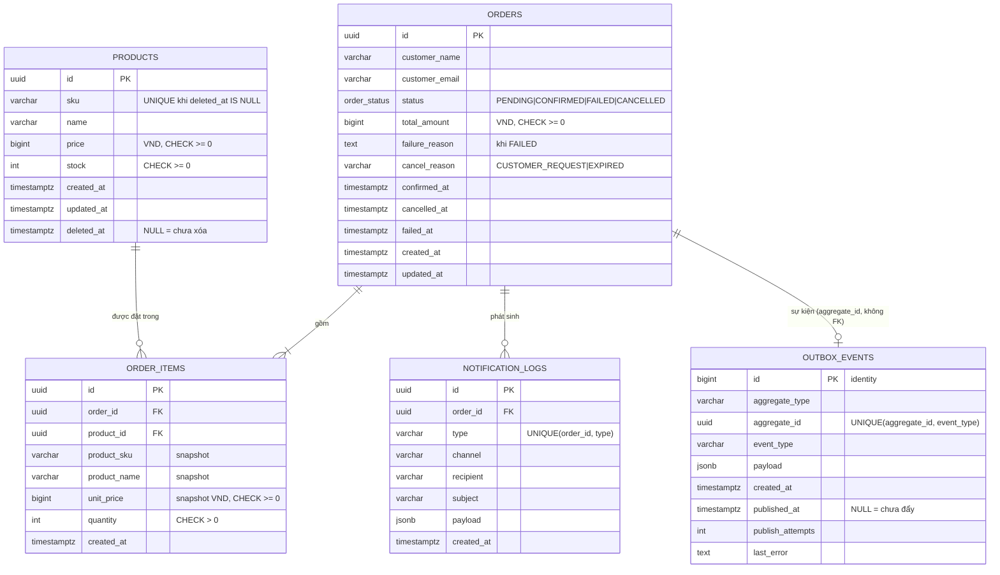

# 03 — Thiết kế dữ liệu

## 1. ERD



## 2. Đặc tả bảng

Quy ước chung: khóa chính là `uuid DEFAULT gen_random_uuid()` (riêng `outbox_events` dùng `bigint identity`, xem [ADR-008](10-technical-decisions.md#adr-008-khóa-chính)), thời gian dùng `timestamptz` (lưu UTC), tiền dùng `bigint` đơn vị VND ([ADR-007](10-technical-decisions.md#adr-007-kiểu-dữ-liệu-tiền)).

### 2.1 `products`

| Cột | Kiểu | Null | Mặc định | Ràng buộc / ghi chú |
|---|---|---|---|---|
| `id` | `uuid` | ✗ | `gen_random_uuid()` | `pk_products` |
| `sku` | `varchar(64)` | ✗ | | Trim và chuyển thành chữ in hoa ở tầng DTO. `uq_products_sku_active` (partial) |
| `name` | `varchar(255)` | ✗ | | |
| `price` | `bigint` | ✗ | | Đơn vị VND. `chk_products_price_non_negative`: `price >= 0` |
| `stock` | `integer` | ✗ | `0` | `chk_products_stock_non_negative`: `stock >= 0`. Đây là **lớp chặn cuối** chống bán vượt |
| `created_at` | `timestamptz` | ✗ | `now()` | `@CreateDateColumn` |
| `updated_at` | `timestamptz` | ✗ | `now()` | `@UpdateDateColumn` |
| `deleted_at` | `timestamptz` | ✓ | `NULL` | `@DeleteDateColumn`. Khác NULL nghĩa là đã xóa mềm |

### 2.2 `orders`

| Cột | Kiểu | Null | Mặc định | Ràng buộc / ghi chú |
|---|---|---|---|---|
| `id` | `uuid` | ✗ | `gen_random_uuid()` | `pk_orders` |
| `customer_name` | `varchar(255)` | ✗ | | |
| `customer_email` | `varchar(255)` | ✗ | | Lưu ở dạng chữ thường |
| `status` | `order_status` (enum) | ✗ | `'PENDING'` | `PENDING`, `CONFIRMED`, `FAILED`, `CANCELLED` |
| `total_amount` | `bigint` | ✗ | | Đơn vị VND. `chk_orders_total_non_negative`. Bằng `Σ unit_price × quantity` |
| `failure_reason` | `text` | ✓ | | Lý do lỗi cuối cùng khi `FAILED` |
| `cancel_reason` | `varchar(32)` | ✓ | | `CUSTOMER_REQUEST` hoặc `EXPIRED` |
| `confirmed_at` | `timestamptz` | ✓ | | Thời điểm chuyển sang `CONFIRMED` |
| `cancelled_at` | `timestamptz` | ✓ | | Thời điểm chuyển sang `CANCELLED` |
| `failed_at` | `timestamptz` | ✓ | | Thời điểm chuyển sang `FAILED` |
| `created_at` | `timestamptz` | ✗ | `now()` | Dùng để tính hết hạn (30 phút) |
| `updated_at` | `timestamptz` | ✗ | `now()` | |

> `total_amount` được lưu (denormalize) thay vì tính lại mỗi lần đọc. Lý do: giá trị đơn là một sự thật lịch sử, không bao giờ đổi sau khi tạo.

### 2.3 `order_items`

| Cột | Kiểu | Null | Ràng buộc / ghi chú |
|---|---|---|---|
| `id` | `uuid` | ✗ | `pk_order_items` |
| `order_id` | `uuid` | ✗ | `fk_order_items_order` → `orders(id)` `ON DELETE CASCADE` |
| `product_id` | `uuid` | ✗ | `fk_order_items_product` → `products(id)` `ON DELETE RESTRICT`. Sản phẩm chỉ xóa mềm nên FK luôn hợp lệ |
| `product_sku` | `varchar(64)` | ✗ | Snapshot tại thời điểm đặt |
| `product_name` | `varchar(255)` | ✗ | Snapshot tại thời điểm đặt |
| `unit_price` | `bigint` | ✗ | Snapshot giá (VND). `chk_order_items_unit_price_non_negative` |
| `quantity` | `integer` | ✗ | `chk_order_items_quantity_positive`: `quantity > 0` |
| `created_at` | `timestamptz` | ✗ | `now()` |
| | | | `uq_order_items_order_product` `UNIQUE(order_id, product_id)`: một sản phẩm xuất hiện tối đa một lần trong mỗi đơn |

`lineTotal = unit_price × quantity` được tính khi trả response, không lưu vào DB.

### 2.4 `notification_logs`

Bảng này thay cho việc gửi email thật. Mỗi dòng là một "thông báo đã gửi".

| Cột | Kiểu | Null | Ràng buộc / ghi chú |
|---|---|---|---|
| `id` | `uuid` | ✗ | `pk_notification_logs` |
| `order_id` | `uuid` | ✗ | `fk_notification_logs_order` → `orders(id)` `ON DELETE CASCADE` |
| `type` | `varchar(32)` | ✗ | `ORDER_CONFIRMED` (bắt buộc). Có thể thêm `ORDER_FAILED`, `ORDER_CANCELLED` |
| `channel` | `varchar(16)` | ✗ | Mặc định `'EMAIL'` |
| `recipient` | `varchar(255)` | ✗ | Email khách |
| `subject` | `varchar(255)` | ✗ | Ví dụ: `Đơn hàng #<id> đã được xác nhận` |
| `payload` | `jsonb` | ✗ | Mặc định `'{}'`. Gồm `orderId`, `totalAmount`, `items`… |
| `created_at` | `timestamptz` | ✗ | `now()` |
| | | | `uq_notification_logs_order_type` `UNIQUE(order_id, type)`. **Đây là bảo đảm idempotency ở tầng DB**: không thể có 2 thông báo `ORDER_CONFIRMED` cho cùng một đơn |

Ghi bằng `INSERT … ON CONFLICT ON CONSTRAINT uq_notification_logs_order_type DO NOTHING`, trong cùng transaction với việc đổi trạng thái đơn.

### 2.5 `outbox_events`

Bảng Transactional Outbox ([ADR-003](10-technical-decisions.md#adr-003-đẩy-job-qua-transactional-outbox)). Transaction tạo đơn ghi một dòng vào đây. Relay trong worker đọc các dòng chưa đẩy và đẩy chúng thành job BullMQ.

| Cột | Kiểu | Null | Mặc định | Ràng buộc / ghi chú |
|---|---|---|---|---|
| `id` | `bigint` | ✗ | `GENERATED ALWAYS AS IDENTITY` | `pk_outbox_events`. Tăng dần, relay quét theo thứ tự ghi |
| `aggregate_type` | `varchar(32)` | ✗ | | `ORDER` |
| `aggregate_id` | `uuid` | ✗ | | `orderId`. **Không** đặt FK để bảng outbox độc lập với vòng đời của aggregate. Relay lấy id đơn từ cột này (Postgres bảo đảm là UUID hợp lệ), không đọc `payload` |
| `event_type` | `varchar(64)` | ✗ | | `ORDER_CREATED` |
| `payload` | `jsonb` | ✗ | | `{ "orderId": "…" }` |
| `created_at` | `timestamptz` | ✗ | `now()` | |
| `published_at` | `timestamptz` | ✓ | `NULL` | `NULL` nghĩa là chưa đẩy sang queue |
| `publish_attempts` | `integer` | ✗ | `0` | Số lần relay đã thử đẩy |
| `last_error` | `text` | ✓ | | Lỗi gần nhất khi đẩy (ví dụ Redis không truy cập được) |
| | | | | `uq_outbox_events_aggregate_event` `UNIQUE(aggregate_id, event_type)`: mỗi đơn có tối đa một sự kiện `ORDER_CREATED` |

Relay lấy lô bằng câu:

```sql
SELECT id, aggregate_id, event_type, payload
  FROM outbox_events
 WHERE published_at IS NULL
 ORDER BY id
 LIMIT $batch
   FOR UPDATE SKIP LOCKED;
```

*(Tùy chọn)* Dọn các dòng đã đẩy quá 7 ngày trong job định kỳ 5 phút, để bảng không phình to.

## 3. Index

| Index | Bảng | Định nghĩa | Phục vụ truy vấn |
|---|---|---|---|
| `uq_products_sku_active` | products | `UNIQUE (sku) WHERE deleted_at IS NULL` | Ràng buộc SKU duy nhất, tra theo SKU |
| `idx_products_created_at` | products | `(created_at DESC, id DESC) WHERE deleted_at IS NULL` | Danh sách sản phẩm mặc định |
| `idx_products_price` | products | `(price) WHERE deleted_at IS NULL` | Lọc `minPrice`/`maxPrice` |
| `idx_products_name_trgm` *(tùy chọn)* | products | `GIN (name gin_trgm_ops)`, cần extension `pg_trgm` | `name ILIKE '%term%'`. B-tree không dùng được cho pattern bắt đầu bằng `%` |
| `idx_orders_status_created_at` | orders | `(status, created_at)` | `GET /orders?status=` và job hủy đơn quá hạn (`status='PENDING' AND created_at < …`) |
| `idx_orders_created_at` | orders | `(created_at DESC, id DESC)` | `GET /orders` không lọc |
| `uq_order_items_order_product` | order_items | `UNIQUE (order_id, product_id)` | Lấy items theo đơn (cột đầu là `order_id`) |
| `idx_order_items_product_id` | order_items | `(product_id)` | Tra cứu theo sản phẩm, kiểm tra FK khi xóa |
| `uq_notification_logs_order_type` | notification_logs | `UNIQUE (order_id, type)` | Chống trùng thông báo, lấy thông báo theo đơn |
| `idx_outbox_events_unpublished` | outbox_events | `(id) WHERE published_at IS NULL` | Relay quét các sự kiện chưa đẩy. Index nhỏ vì chỉ chứa các dòng còn tồn đọng |
| `uq_outbox_events_aggregate_event` | outbox_events | `UNIQUE (aggregate_id, event_type)` | Chống trùng sự kiện, tra `dispatch` cho `GET /orders/:id/jobs` |

## 4. DDL tham chiếu

Migration TypeORM sẽ sinh ra hoặc viết tay tương đương với đoạn SQL dưới đây. Đoạn SQL dùng để review và để giải thích khi phỏng vấn.

```sql
-- products
CREATE TABLE products (
  id          uuid          NOT NULL DEFAULT gen_random_uuid(),
  sku         varchar(64)   NOT NULL,
  name        varchar(255)  NOT NULL,
  price       bigint        NOT NULL,
  stock       integer       NOT NULL DEFAULT 0,
  created_at  timestamptz   NOT NULL DEFAULT now(),
  updated_at  timestamptz   NOT NULL DEFAULT now(),
  deleted_at  timestamptz   NULL,
  CONSTRAINT pk_products PRIMARY KEY (id),
  CONSTRAINT chk_products_price_non_negative CHECK (price >= 0),
  CONSTRAINT chk_products_stock_non_negative CHECK (stock >= 0)
);
CREATE UNIQUE INDEX uq_products_sku_active ON products (sku) WHERE deleted_at IS NULL;
CREATE INDEX idx_products_created_at ON products (created_at DESC, id DESC) WHERE deleted_at IS NULL;
CREATE INDEX idx_products_price ON products (price) WHERE deleted_at IS NULL;

-- orders
CREATE TYPE order_status AS ENUM ('PENDING', 'CONFIRMED', 'FAILED', 'CANCELLED');

CREATE TABLE orders (
  id              uuid          NOT NULL DEFAULT gen_random_uuid(),
  customer_name   varchar(255)  NOT NULL,
  customer_email  varchar(255)  NOT NULL,
  status          order_status  NOT NULL DEFAULT 'PENDING',
  total_amount    bigint        NOT NULL,
  failure_reason  text          NULL,
  cancel_reason   varchar(32)   NULL,
  confirmed_at    timestamptz   NULL,
  cancelled_at    timestamptz   NULL,
  failed_at       timestamptz   NULL,
  created_at      timestamptz   NOT NULL DEFAULT now(),
  updated_at      timestamptz   NOT NULL DEFAULT now(),
  CONSTRAINT pk_orders PRIMARY KEY (id),
  CONSTRAINT chk_orders_total_non_negative CHECK (total_amount >= 0)
);
CREATE INDEX idx_orders_status_created_at ON orders (status, created_at);
CREATE INDEX idx_orders_created_at ON orders (created_at DESC, id DESC);

-- order_items
CREATE TABLE order_items (
  id            uuid          NOT NULL DEFAULT gen_random_uuid(),
  order_id      uuid          NOT NULL,
  product_id    uuid          NOT NULL,
  product_sku   varchar(64)   NOT NULL,
  product_name  varchar(255)  NOT NULL,
  unit_price    bigint        NOT NULL,
  quantity      integer       NOT NULL,
  created_at    timestamptz   NOT NULL DEFAULT now(),
  CONSTRAINT pk_order_items PRIMARY KEY (id),
  CONSTRAINT fk_order_items_order   FOREIGN KEY (order_id)   REFERENCES orders(id)   ON DELETE CASCADE,
  CONSTRAINT fk_order_items_product FOREIGN KEY (product_id) REFERENCES products(id) ON DELETE RESTRICT,
  CONSTRAINT uq_order_items_order_product UNIQUE (order_id, product_id),
  CONSTRAINT chk_order_items_quantity_positive CHECK (quantity > 0),
  CONSTRAINT chk_order_items_unit_price_non_negative CHECK (unit_price >= 0)
);
CREATE INDEX idx_order_items_product_id ON order_items (product_id);

-- notification_logs
CREATE TABLE notification_logs (
  id          uuid          NOT NULL DEFAULT gen_random_uuid(),
  order_id    uuid          NOT NULL,
  type        varchar(32)   NOT NULL,
  channel     varchar(16)   NOT NULL DEFAULT 'EMAIL',
  recipient   varchar(255)  NOT NULL,
  subject     varchar(255)  NOT NULL,
  payload     jsonb         NOT NULL DEFAULT '{}'::jsonb,
  created_at  timestamptz   NOT NULL DEFAULT now(),
  CONSTRAINT pk_notification_logs PRIMARY KEY (id),
  CONSTRAINT fk_notification_logs_order FOREIGN KEY (order_id) REFERENCES orders(id) ON DELETE CASCADE,
  CONSTRAINT uq_notification_logs_order_type UNIQUE (order_id, type)
);

-- outbox_events
CREATE TABLE outbox_events (
  id                bigint        GENERATED ALWAYS AS IDENTITY,
  aggregate_type    varchar(32)   NOT NULL,
  aggregate_id      uuid          NOT NULL,
  event_type        varchar(64)   NOT NULL,
  payload           jsonb         NOT NULL,
  created_at        timestamptz   NOT NULL DEFAULT now(),
  published_at      timestamptz   NULL,
  publish_attempts  integer       NOT NULL DEFAULT 0,
  last_error        text          NULL,
  CONSTRAINT pk_outbox_events PRIMARY KEY (id),
  CONSTRAINT uq_outbox_events_aggregate_event UNIQUE (aggregate_id, event_type)
);
CREATE INDEX idx_outbox_events_unpublished ON outbox_events (id) WHERE published_at IS NULL;
```

## 5. Xử lý tiền tệ

Quyết định: [ADR-007](10-technical-decisions.md#adr-007-kiểu-dữ-liệu-tiền).

- Lưu bằng `bigint`, đơn vị **VND** (không có phần lẻ). **Không** dùng `float`/`double precision`/`numeric`.
- Driver `pg` trả `int8` dưới dạng **string**. Entity dùng `BigIntTransformer` để API trả về `number`:
  ```ts
  export const BigIntTransformer: ValueTransformer = {
    to: (v?: number | null) => v,
    from: (v?: string | null) => {
      if (v === null || v === undefined) return v;
      const n = Number(v);
      if (!Number.isSafeInteger(n)) throw new Error(`bigint value out of safe range: ${v}`);
      return n;
    },
  };
  ```
- Tính tổng là phép cộng số nguyên thuần: `total = Σ unitPrice × quantity`.
- **Giới hạn để luôn nằm trong vùng số nguyên an toàn của JS:** DTO giới hạn `price ≤ 1_000_000_000`, `quantity ≤ 1000`, `items ≤ 50`. Vậy `total ≤ 5 × 10¹³`, nhỏ hơn rất nhiều so với `Number.MAX_SAFE_INTEGER ≈ 9 × 10¹⁵`.
- DTO dùng `@IsInt()` cho `price`, `minPrice`, `maxPrice`. Giá trị thập phân trả `400`.

## 6. Hành vi xóa mềm

| Tình huống | Hành vi |
|---|---|
| `GET /products`, `GET /products/:id` | Bỏ qua sản phẩm đã xóa (TypeORM tự thêm `deleted_at IS NULL` cho entity có `@DeleteDateColumn`) |
| `DELETE /products/:id` | `softDelete()` đặt `deleted_at = now()`. Gọi lần 2 trả `404` |
| Tạo đơn với sản phẩm đã xóa | Câu khóa dòng có điều kiện `deleted_at IS NULL` nên không tìm thấy, trả `404 PRODUCT_NOT_FOUND` |
| Xóa trong lúc một đơn đang khóa sản phẩm | `UPDATE … SET deleted_at` phải chờ khóa dòng. Một trong hai bên thắng, dữ liệu vẫn nhất quán |
| Xem đơn cũ chứa sản phẩm đã xóa | Hiển thị từ snapshot `product_sku`/`product_name`/`unit_price`, không cần join `products` |
| Hủy hoặc thất bại đơn chứa sản phẩm đã xóa | **Vẫn hoàn kho** (cập nhật theo `id`, không lọc `deleted_at`), để nếu sản phẩm được khôi phục thì tồn kho vẫn đúng |
| SKU của sản phẩm đã xóa | Dùng lại được nhờ partial unique index |

## 7. Kế hoạch migration

- `synchronize: false` ở **mọi** môi trường. `migrationsRun: false`: không tự chạy migration khi app khởi động (đặc biệt quan trọng trên Vercel, nơi mỗi lần cold start sẽ khởi động lại app).
- DataSource cho CLI nằm ở `src/database/data-source.ts`, đọc `.env` qua `dotenv` (không ghi đè biến môi trường thật) rồi validate env giống lúc app khởi động.
- `src/database/typeorm.options.ts` (`buildTypeOrmOptions`) dùng chung cho app và CLI: `poolSize = DATABASE_POOL_MAX`, `ssl = DATABASE_SSL`, glob `entities`/`migrations` tính theo vị trí file nên chạy được cả từ `src/*.ts` (ts-node) lẫn `dist/*.js`. `uuidExtension: pgcrypto` để TypeORM sinh `gen_random_uuid()` (có sẵn từ PG13) và `installExtensions: false` để không chạy `CREATE EXTENSION "uuid-ossp"` mỗi lần kết nối.
- Mỗi migration có `up` và `down` đầy đủ, `down` đảo ngược đúng thứ tự.

| # | Migration | Nội dung |
|---|---|---|
| 1 | `CreateProducts` | Bảng `products`, CHECK, partial unique index SKU, các index |
| 2 | `CreateOrders` | Enum `order_status`, bảng `orders`, `order_items`, FK, CHECK, index |
| 3 | `CreateOutboxEvents` | Bảng `outbox_events`, unique `(aggregate_id, event_type)`, partial index cho sự kiện chưa đẩy |
| 4 | `CreateNotificationLogs` | Bảng `notification_logs`, unique `(order_id, type)` |
| 5 *(tùy chọn, xem [ADR-028](10-technical-decisions.md#adr-028-phạm-vi-bổ-sung))* | `AddProductNameTrgmIndex` | `CREATE EXTENSION IF NOT EXISTS pg_trgm` và GIN index. Viết tay vì TypeORM không generate được extension |

Script npm (chi tiết ở [08 §2](08-deployment.md#2-chạy-local)):

```jsonc
{
  "typeorm": "typeorm-ts-node-commonjs -d src/database/data-source.ts",
  "migration:generate": "npm run typeorm -- migration:generate",   // + đường dẫn, ví dụ src/database/migrations/CreateOrders
  "migration:create": "typeorm-ts-node-commonjs migration:create",  // + đường dẫn
  "migration:run": "npm run typeorm -- migration:run",
  "migration:revert": "npm run typeorm -- migration:revert",
  "migration:show": "npm run typeorm -- migration:show",            // liệt kê migration đã/chưa chạy
  "migration:run:prod": "typeorm -d dist/database/data-source.js migration:run"
}
```

> Trên Windows, npm script không nhận `$NAME`, nên tên migration được truyền trực tiếp: `npm run migration:generate -- src/database/migrations/CreateOrders`.
> Sau khi generate **phải đọc lại** migration: kiểm tra tên constraint, partial index và enum. Đây là code sẽ bị hỏi khi phỏng vấn.
> Entity khai báo lại đúng tên constraint và index của migration (`@Check`, `@Index`, `primaryKeyConstraintName`). Partial index chỉ có điều kiện `WHERE` (ví dụ `uq_products_sku_active`, `idx_products_price`) được khai báo đầy đủ bằng `@Index(name, columns, { where })`. Index có `DESC` hoặc điều kiện phức tạp mà `@Index` không mô tả được (ví dụ `idx_products_created_at`) được đánh dấu `@Index(name, { synchronize: false })` để TypeORM bỏ qua. Kiểm tra entity khớp với DB bằng `npm run migration:generate -- src/database/migrations/DriftCheck --dr`: kết quả đúng là "No changes in database schema were found".

## 8. Dữ liệu mẫu (seed, tùy chọn)

Script `npm run seed` tạo khoảng 10 sản phẩm, trong đó có ít nhất một sản phẩm `stock = 1` (`LAST-ITEM-001`) để demo tình huống tranh chấp món cuối.
