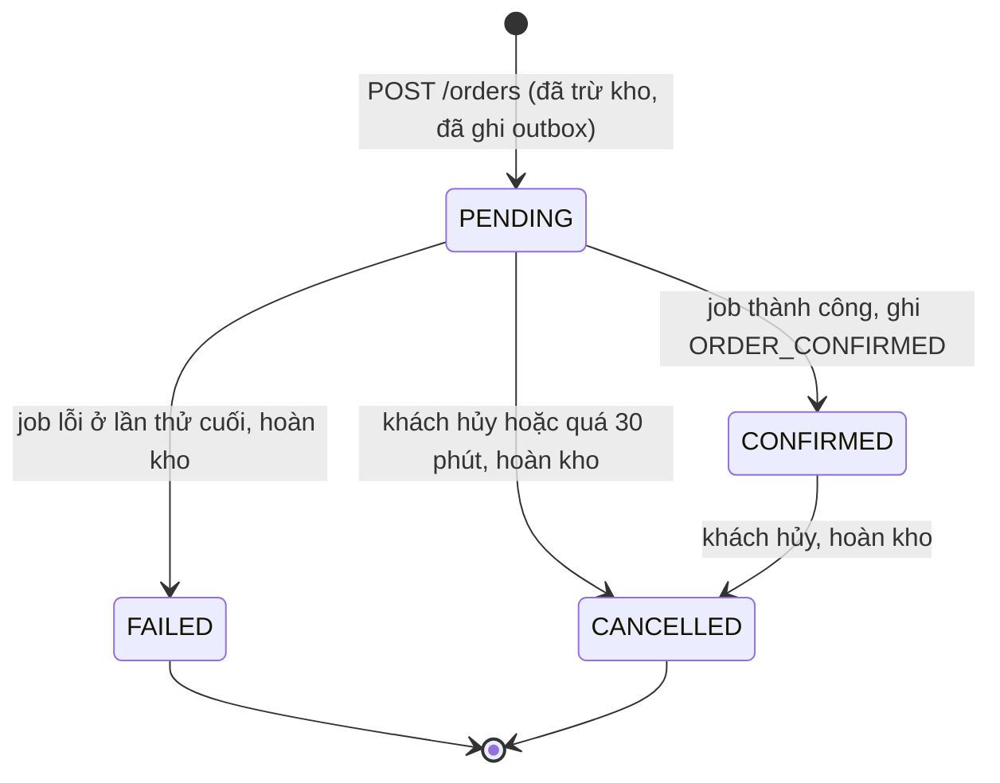
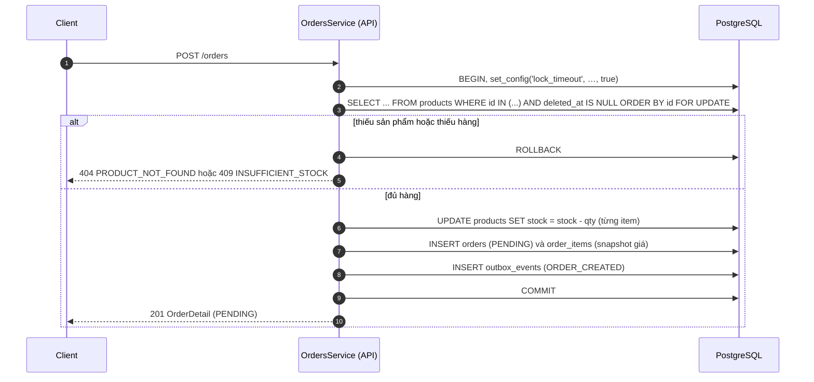
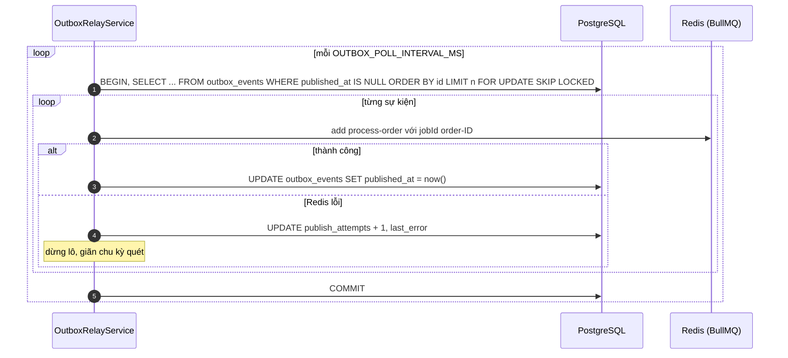
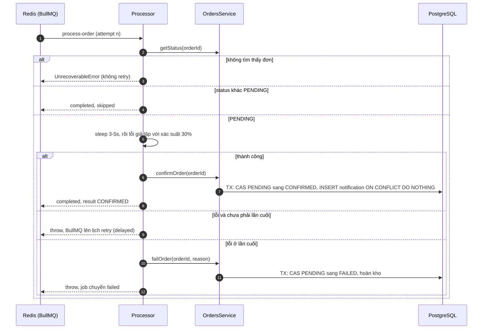

# 05 — Luồng xử lý đơn hàng và job nền

> Các quyết định liên quan: [ADR-001](10-technical-decisions.md#adr-001-số-lần-chạy-job-và-backoff) (retry), [ADR-003](10-technical-decisions.md#adr-003-đẩy-job-qua-transactional-outbox) (Outbox), [ADR-015](10-technical-decisions.md#adr-015-chuyển-trạng-thái-bằng-cas) (CAS), [ADR-017](10-technical-decisions.md#adr-017-bù-trừ-ở-lần-thử-cuối) (bù trừ).

## 1. Tổng quan

Vòng đời một đơn hàng gồm ba bước:

1. **Tạo đơn (API, đồng bộ):** kiểm tra và trừ kho, tạo đơn `PENDING`, ghi sự kiện `ORDER_CREATED` vào `outbox_events`, tất cả trong **một transaction**. Khách nhận `201` ngay. API **không gọi Redis** ở bước này.
2. **Relay (Worker):** `OutboxRelayService` quét outbox khoảng mỗi giây, đẩy sự kiện thành job `process-order` vào queue rồi đánh dấu đã đẩy.
3. **Xử lý (Worker):** job giả lập xử lý 3–5 giây, rồi xác nhận đơn và ghi thông báo. Nếu lỗi thì retry. Nếu lỗi đến lần thử cuối thì đánh dấu `FAILED` và hoàn kho.

Song song đó, job định kỳ `expire-pending-orders` dọn các đơn `PENDING` bị kẹt quá 30 phút.

**Bất biến cốt lõi:** mọi tác dụng phụ (hoàn kho, ghi thông báo) chỉ được thực hiện **trong cùng transaction với một lần chuyển trạng thái CAS thành công**. Đây là nền tảng của tính idempotent.

## 2. Máy trạng thái



| Từ | Sang | Kích hoạt bởi | Điều kiện CAS (`WHERE`) | Tác dụng phụ trong cùng transaction | Cột được set |
|---|---|---|---|---|---|
| — | `PENDING` | `POST /orders` | — | Khóa và trừ kho, insert `order_items`, insert `outbox_events` (`ORDER_CREATED`) | `total_amount` |
| `PENDING` | `CONFIRMED` | Job `process-order` thành công | `status = 'PENDING'` | Insert `notification_logs` (`ORDER_CONFIRMED`) `ON CONFLICT DO NOTHING` | `confirmed_at` |
| `PENDING` | `FAILED` | Job lỗi ở lần thử cuối | `status = 'PENDING'` | Hoàn kho | `failure_reason`, `failed_at` |
| `PENDING`, `CONFIRMED` | `CANCELLED` | `PATCH /orders/:id/cancel` | `status IN ('PENDING','CONFIRMED')` | Hoàn kho | `cancel_reason = CUSTOMER_REQUEST`, `cancelled_at` |
| `PENDING` | `CANCELLED` | Job `expire-pending-orders` | `status = 'PENDING'` (đơn được chọn trước bằng `created_at < now() − TTL`, cột này không bao giờ đổi) | Hoàn kho | `cancel_reason = EXPIRED`, `cancelled_at` |

`FAILED` và `CANCELLED` là trạng thái cuối. Mọi chuyển trạng thái có hoàn kho đều xuất phát từ `PENDING` hoặc `CONFIRMED` và đều đi đến trạng thái cuối. Do đó **mỗi đơn được hoàn kho tối đa một lần**.

### 2.1 Thao tác CAS dùng chung

`OrdersRepository.transitionStatus(manager, orderId, from[], to, patch)`, trong đó `patch` chỉ chứa lý do (`cancelReason` hoặc `failureReason`):

```sql
UPDATE orders
   SET status = $to, updated_at = now(), <to>_at = now() /* confirmed_at | failed_at | cancelled_at */, cancel_reason | failure_reason = $reason
 WHERE id = $orderId
   AND status = ANY($from)
RETURNING id, status, customer_email, total_amount;
```

- Cột thời điểm của trạng thái đích (`confirmed_at`, `failed_at`, `cancelled_at`) do repository tự đặt bằng `now()` của Postgres, cùng đồng hồ với `created_at`/`updated_at`. Nơi gọi không truyền `new Date()`, vì đồng hồ của máy chạy Node có thể lệch với đồng hồ DB (ví dụ máy ảo Docker).

- Trả về dòng đơn nếu cập nhật được, `null` nếu không có dòng nào khớp (đơn không tồn tại, hoặc đã ở trạng thái khác).
- `UPDATE` lấy khóa dòng trên `orders`. Hai transaction cùng CAS một đơn sẽ chạy tuần tự. Bên đến sau, sau khi chờ khóa, sẽ **đánh giá lại `WHERE` trên phiên bản dòng mới nhất**, thấy trạng thái đã đổi và không cập nhật gì.

### 2.2 Hoàn kho dùng chung

`OrdersService.releaseStock(manager, orderId)`, chỉ gọi **sau** khi CAS thành công:

```sql
SELECT product_id, quantity FROM order_items WHERE order_id = $1 ORDER BY product_id;
-- với từng item, theo thứ tự product_id tăng dần (cùng thứ tự khóa với lúc tạo đơn):
UPDATE products SET stock = stock + $quantity, updated_at = now() WHERE id = $productId;  -- không lọc deleted_at
```

> Không dùng một câu `UPDATE … FROM order_items` duy nhất, vì thứ tự khóa của câu đó không xác định, có thể deadlock với transaction tạo đơn ([06 §5](06-concurrency.md#5-chống-deadlock)).

## 3. Luồng tạo đơn và Outbox

### 3.1 Tạo đơn (API)



```ts
async create(dto: CreateOrderDto): Promise<OrderDetailDto> {
  const order = await this.dataSource.transaction(async (manager) => {
    await this.setLockTimeout(manager);

    const items = dto.items; // productId đã được DTO chuẩn hóa thành chữ thường
    // Khóa mọi sản phẩm trong MỘT câu, theo thứ tự id do Postgres sắp xếp (06 §5)
    const products = await this.stockRepo.findActiveForUpdate(manager, items.map((i) => i.productId));
    const byId = new Map(products.map((p) => [p.id, p]));

    const missing = items.filter((i) => !byId.has(i.productId));
    if (missing.length) throw AppException.productNotFound(missing.map((i) => i.productId));

    const shortages = items
      .map((i) => ({ item: i, product: byId.get(i.productId)! }))
      .filter(({ item, product }) => product.stock < item.quantity);
    if (shortages.length) throw AppException.insufficientStock(shortages);   // rollback toàn bộ

    for (const item of items) {
      // Đã giữ khóa mọi dòng nên thứ tự UPDATE ở đây không ảnh hưởng deadlock
      await this.stockRepo.decrementStock(manager, item.productId, item.quantity);
    }

    const lines = items.map((i) => {
      const p = byId.get(i.productId)!;
      return { productId: p.id, productSku: p.sku, productName: p.name, unitPrice: p.price, quantity: i.quantity };
    });
    const created = await this.ordersRepo.insertWithItems(manager, {
      customerName: dto.customerName,
      customerEmail: dto.customerEmail,
      status: OrderStatus.PENDING,
      totalAmount: lines.reduce((sum, l) => sum + l.unitPrice * l.quantity, 0), // số nguyên VND (03 §5)
      items: lines,
    });

    // Cùng transaction: đơn và sự kiện cùng commit hoặc cùng rollback
    await this.outboxRepo.add(manager, {
      aggregateType: 'ORDER',
      aggregateId: created.id,
      eventType: OutboxEventType.ORDER_CREATED,
      payload: { orderId: created.id },
    });
    return created;
  });

  return toOrderDetail(order); // không có I/O Redis trên đường đi này
}
```

> Code thật (`src/orders/orders.service.ts`) khác mẫu trên ở vài điểm nhỏ: các dòng của đơn được dựng theo thứ tự sản phẩm mà câu khóa trả về (`id` tăng dần), nên việc trừ kho, `order_items` và `items` trong response đều theo thứ tự `productId`. Tổng tiền tính bằng `calculateOrderTotal` (kiểm tra safe integer, [03 §5](03-database.md#5-xử-lý-tiền-tệ)). `setLockTimeout` chạy `SELECT set_config('lock_timeout', $1, true)` ([06 §8](06-concurrency.md#8-vận-hành-và-giới-hạn)). Service trả entity `Order`, controller chuyển sang `OrderDetailDto`.

### 3.2 Relay (Worker)



```ts
@Injectable()
export class OutboxRelayService implements OnApplicationBootstrap, OnModuleDestroy {
  private timer?: NodeJS.Timeout;
  private stopped = false;
  private delayMs = 0;

  onApplicationBootstrap() {
    this.delayMs = this.cfg.pollIntervalMs;
    this.schedule(0);
  }

  onModuleDestroy() {
    this.stopped = true;
    clearTimeout(this.timer);
  }

  private schedule(ms: number) {
    if (!this.stopped) this.timer = setTimeout(() => void this.tick(), ms);
  }

  private async tick() {
    const result = await this.relayBatch().catch((err) => {
      this.logger.error('Outbox relay batch failed', err);
      return { published: 0, failed: true };
    });
    // Lỗi: giãn chu kỳ gấp đôi, tối đa OUTBOX_MAX_BACKOFF_MS. Lô đầy: quét tiếp ngay. Còn lại: chu kỳ bình thường
    this.delayMs = result.failed ? Math.min(this.delayMs * 2, this.cfg.maxBackoffMs) : this.cfg.pollIntervalMs;
    this.schedule(!result.failed && result.published === this.cfg.batchSize ? 0 : this.delayMs);
  }

  /** Public để unit test gọi trực tiếp. */
  relayBatch(): Promise<{ published: number; failed: boolean }> {
    return this.dataSource.transaction(async (manager) => {
      const events = await this.outboxRepo.claimBatch(manager, this.cfg.batchSize); // FOR UPDATE SKIP LOCKED
      let published = 0;
      for (const event of events) {
        try {
          await this.orderQueue.enqueueProcessOrder(event.payload.orderId); // jobId cố định: đẩy trùng là no-op
          await this.outboxRepo.markPublished(manager, event.id);
          published++;
        } catch (err) {
          await this.outboxRepo.markFailed(manager, event.id, toMessage(err));
          return { published, failed: true }; // Redis có vấn đề: dừng lô, vẫn COMMIT phần đã làm
        }
      }
      return { published, failed: false };
    });
  }
}
```

Code thật (`src/outbox/outbox-relay.service.ts`, `src/outbox/outbox.repository.ts`) khác mẫu ở vài điểm:

- **Dừng gọn:** `onModuleDestroy` đặt cờ dừng, hủy timer rồi **chờ lô đang chạy commit xong**. Hook này chạy trước `onApplicationShutdown`, nơi Nest đóng DataSource và kết nối Redis, nên lô không bị cắt ngang giữa chừng. Sau khi dừng, `schedule()` không đặt timer mới.
- **Payload sai:** nếu `payload.orderId` không phải UUID, sự kiện bị `markFailed` với lý do `Invalid ORDER_CREATED payload: …` và relay đi tiếp sang sự kiện sau. Lỗi này không phải lỗi Redis nên không làm giãn chu kỳ quét, cũng không làm dừng lô.
- **Đếm lần thử:** `markPublished` đặt `published_at = now()` (đồng hồ DB) **và** tăng `publish_attempts`, nên một sự kiện đẩy được ngay có `publishAttempts = 1` ([04 §4.6](04-api-spec.md#46-get-ordersidjobs)). `last_error` được giữ lại sau khi đẩy thành công, để biết vì sao sự kiện bị trễ. `markFailed` cắt `last_error` còn tối đa 1000 ký tự.
- **Timeout:** `enqueueProcessOrder` có timeout 3s (§4.1). Khi Redis tắt, `last_error` thường là `Redis did not answer within 3000 ms`, log `WARN` của queue ghi lỗi gốc (ví dụ `connect ECONNREFUSED`).
- **Log:** `Outbox relay started (…)`, `Published N outbox event(s)` khi có sự kiện được đẩy, và `Outbox relay: next poll in N ms` mỗi lần giãn chu kỳ (2s, 4s, 8s, 16s, 30s).
- Chạy nhiều relay cùng lúc: relay nào không lấy được dòng nào (vì dòng đang bị instance khác khóa, `SKIP LOCKED`) thì coi như lô thành công và quét lại theo chu kỳ bình thường.

### 3.3 Vì sao chọn Outbox

| Cách làm | Vấn đề |
|---|---|
| Đẩy job **trong** transaction | Worker có thể nhận job trước khi commit và không thấy đơn. Nếu sau đó rollback, job trỏ tới đơn không tồn tại |
| Đẩy job **sau** commit | Redis lỗi đúng lúc đó thì mất job, đơn nằm `PENDING` không ai xử lý |
| **Outbox** | Đơn và sự kiện được ghi **nguyên tử**. Relay đẩy lại cho tới khi thành công |

**Bảo đảm:**

- **Không mất job:** sự kiện tồn tại khi và chỉ khi đơn tồn tại.
- **At-least-once và consumer idempotent cho kết quả như exactly-once:** relay có thể đẩy một sự kiện nhiều lần (ví dụ crash giữa `queue.add` và `COMMIT`). `jobId` cố định khiến BullMQ bỏ qua lần đẩy trùng. Các lớp L2/L3 (§6) bảo vệ phần còn lại.
- **`POST /orders` không phụ thuộc Redis.**
- **Chạy nhiều relay song song an toàn:** `FOR UPDATE SKIP LOCKED` chia sự kiện cho các instance, không chặn nhau.
- **Ngoại lệ có chủ đích:** transaction của relay giữ khóa dòng `outbox_events` trong lúc gọi Redis. Khóa chỉ nằm trên bảng outbox, không đụng tới `products`/`orders`.
- **Độ trễ:** thêm tối đa `OUTBOX_POLL_INTERVAL_MS` (1s) trước khi xử lý, không đáng kể so với 3–5s xử lý.

## 4. Retry & backoff

### 4.1 Cấu hình job `process-order`

| Thuộc tính | Giá trị | Ghi chú |
|---|---|---|
| Queue | `order-processing` | Hằng `ORDER_PROCESSING_QUEUE` |
| Job name | `process-order` | `OrderJobName.ProcessOrder` |
| `jobId` | `order-{orderId}` | Cố định để chặn job trùng ([ADR-016](10-technical-decisions.md#adr-016-jobid-cố-định)). Không dùng `:` trong id tùy biến của BullMQ |
| `data` | `{ orderId: string }` | Chỉ truyền id, worker luôn đọc trạng thái mới nhất từ DB |
| `attempts` | `4` (`JOB_ATTEMPTS`) | Lần đầu và 3 retry ([ADR-001](10-technical-decisions.md#adr-001-số-lần-chạy-job-và-backoff)) |
| `backoff` | `{ type: 'exponential', delay: 2000 }` | Chờ `delay × 2^(n−1)`: 2s, 4s, 8s |
| `removeOnComplete` | `{ age: 604800 }` | Giữ 7 ngày để `GET /orders/:id/jobs` còn tra được |
| `removeOnFail` | `{ age: 1209600 }` | Giữ 14 ngày |
| Worker `concurrency` | `5` (`WORKER_CONCURRENCY`) | |
| Lock duration | Mặc định (30s) | Lớn hơn nhiều so với 5s xử lý |

`OrderQueueProducer.enqueueProcessOrder`, được relay gọi:

```ts
await this.queue.add(
  OrderJobName.ProcessOrder,
  { orderId },
  {
    jobId: buildOrderJobId(orderId), // `order-${orderId}`
    attempts: this.cfg.jobAttempts,  // 4
    backoff: { type: 'exponential', delay: this.cfg.jobBackoffDelayMs },
    removeOnComplete: { age: this.cfg.keepCompletedSeconds },
    removeOnFail: { age: this.cfg.keepFailedSeconds },
  },
);
```

Code thật (`src/queue/order-queue.producer.ts`) bọc lời gọi `add` (và `getJob` của §10) bằng `withTimeout(…, REDIS_OPERATION_TIMEOUT_MS = 3000)`: Redis không trả lời trong 3s thì relay nhận lỗi và ghi vào outbox thay vì treo cả lô ([02 §7](02-architecture.md#7-cấu-hình-biến-môi-trường)). Lệnh `add` bị bỏ dở vẫn có thể chạy khi Redis sống lại, việc này an toàn nhờ `jobId` cố định.

### 4.2 Dòng thời gian khi lỗi liên tục

| Lần chạy | Bắt đầu | Thời gian chạy | Nếu lỗi |
|---|---|---|---|
| 1 | Khoảng ≤ 1s sau khi tạo đơn (relay) | 3–5s | Job vào `delayed`, chờ 2s |
| 2 (retry 1) | +2s | 3–5s | `delayed`, chờ 4s |
| 3 (retry 2) | +4s | 3–5s | `delayed`, chờ 8s |
| 4 (retry 3, cuối) | +8s | 3–5s | `failOrder()`: `FAILED` và hoàn kho, job vào `failed` |

Trường hợp xấu nhất mất khoảng `4 × 5 + 2 + 4 + 8 = 34s`. Với tỉ lệ lỗi 30%: xác suất `CONFIRMED` ngay lần đầu là 70%, xác suất `FAILED` là `0.3⁴ ≈ 0.81%`.

## 5. Xử lý job `process-order`



```ts
@Processor(ORDER_PROCESSING_QUEUE)
export class OrderProcessingProcessor extends WorkerHost {
  async process(job: Job): Promise<unknown> {
    switch (job.name) {
      case OrderJobName.ProcessOrder:
        return this.processOrder(job as Job<ProcessOrderJobData>);
      case OrderJobName.ExpirePendingOrders:
        return this.ordersService.expireStaleOrders();
      default:
        throw new UnrecoverableError(`Unknown job name: ${job.name}`);
    }
  }

  private async processOrder(job: Job<ProcessOrderJobData>) {
    const { orderId } = job.data;
    const status = await this.ordersService.getStatus(orderId);
    if (status === null) throw new UnrecoverableError(`Order ${orderId} not found`);
    if (status !== OrderStatus.PENDING) return { skipped: true, reason: `Order is ${status}` };

    try {
      await this.sleeper.sleep(this.randomDelay());   // JOB_PROCESSING_MIN_MS..MAX_MS
      this.failureSimulator.maybeFail();              // throw với xác suất JOB_FAILURE_RATE
      const confirmed = await this.ordersService.confirmOrder(orderId);
      return confirmed ? { result: 'CONFIRMED' } : { skipped: true, reason: 'Order no longer PENDING' };
    } catch (error) {
      if (this.isFinalAttempt(job)) {
        await this.ordersService
          .failOrder(orderId, toMessage(error))
          .catch((e) => this.logger.error(`failOrder failed for ${orderId}; expiry job will clean up`, e));
      }
      throw error; // BullMQ ghi failedReason, retry nếu còn lượt
    }
  }

  private isFinalAttempt(job: Job): boolean {
    // Trong lúc đang xử lý, attemptsMade = số lần thử đã kết thúc trước đó (0 ở lần đầu)
    return job.attemptsMade + 1 >= (job.opts.attempts ?? 1);
  }
}
```

`OrdersService` phía worker:

```ts
async confirmOrder(orderId: string): Promise<boolean> {
  return this.dataSource.transaction(async (manager) => {
    const order = await this.ordersRepo.transitionStatus(manager, orderId, [OrderStatus.PENDING], OrderStatus.CONFIRMED);
    if (!order) return false; // CAS thua: đơn đã bị hủy, hết hạn, hoặc đã được xác nhận
    await this.notificationsRepo.insertIfAbsent(manager, {
      orderId, type: NotificationType.ORDER_CONFIRMED, recipient: order.customerEmail,
      subject: `Order ${orderId} confirmed`, payload: { orderId, totalAmount: order.totalAmount },
    });
    return true;
  });
}

async failOrder(orderId: string, reason: string): Promise<boolean> {
  return this.dataSource.transaction(async (manager) => {
    const order = await this.ordersRepo.transitionStatus(manager, orderId, [OrderStatus.PENDING], OrderStatus.FAILED, { failureReason: reason });
    if (!order) return false;
    await this.releaseStock(manager, orderId);
    return true;
  });
}
```

Code thật (`src/queue/order-processing.processor.ts`, `src/orders/orders.service.ts`):

- **Concurrency:** option của `@Processor` được cố định lúc định nghĩa class, trước khi config được nạp, nên không đọc được `WORKER_CONCURRENCY`. Processor đặt `this.worker.concurrency = WORKER_CONCURRENCY` trong `onModuleInit`. Hook này chạy sau khi `@nestjs/bullmq` tạo `Worker` (module của BullMQ nằm sâu hơn nên được init trước), và BullMQ đọc lại giá trị này trước mỗi lần lấy job.
- **Đóng Worker:** processor gọi `await this.worker.close()` trong `onModuleDestroy` (chờ job đang chạy xong). Nest gọi hook tắt máy theo thứ tự từ module gốc vào trong, nên nếu để `@nestjs/bullmq` tự đóng `Worker` ở `onApplicationShutdown`, DataSource của TypeORM (module nông hơn) đã bị đóng trước, và job đang chạy sẽ lỗi khi ghi DB.
- **Thời gian xử lý:** số nguyên ngẫu nhiên trong `[JOB_PROCESSING_MIN_MS, JOB_PROCESSING_MAX_MS]`, lấy từ `RANDOM_SOURCE` (`Math.random` trong worker). `FailureSimulator.maybeFail()` ném `SimulatedFailureError('Simulated random processing failure')` khi `random() < JOB_FAILURE_RATE`.
- **Log:** mỗi dòng có `orderId`, `attempt n/N` và `jobId`, ví dụ `Processing order <id> (attempt 2/4, job order-<id>)`, `Order <id> confirmed (…)`, `Order <id> failed (…): <lỗi>`, `Order <id> skipped (…): it is CONFIRMED`.
- **Kết quả trả về** (lưu ở `returnvalue` của job): `{ result: 'CONFIRMED' }`, `{ skipped: true, reason: 'Order is CANCELLED' }` hoặc `{ skipped: true, reason: 'Order is no longer PENDING' }` (CAS thua sau khi đã sleep).
- Listener `@OnWorkerEvent('error')` ghi lỗi Redis của `Worker` bằng `createRedisErrorLogger` ([02 §7](02-architecture.md#7-cấu-hình-biến-môi-trường)).

**Quyết định thiết kế:**

- **Bù trừ ngay trong processor ở lần thử cuối**, không dùng event `failed` của worker ([ADR-017](10-technical-decisions.md#adr-017-bù-trừ-ở-lần-thử-cuối)). Lý do: handler của event không được BullMQ `await` và chạy sau khi job đã bị đánh dấu `failed`. Nếu tiến trình chết đúng lúc đó, bước bù trừ bị mất mà không để lại dấu vết. Bù trừ trong processor gắn chặt với lần thử, và vẫn có job hết hạn làm lưới an toàn.
- **Lỗi giả lập đặt trước transaction xác nhận.** Nếu lỗi xảy ra *sau* commit (ví dụ crash trước khi BullMQ ghi nhận `completed`), lần retry sẽ thấy `CONFIRMED` và bỏ qua. Trường hợp này vẫn an toàn.
- **`UnrecoverableError`** khi không tìm thấy đơn, vì retry cũng vô ích.
- `FailureSimulator` và `sleeper` là provider inject được, để unit test ép được kết quả thành công/lỗi.
- **Ngữ nghĩa `attemptsMade` đã được kiểm chứng với BullMQ 6.3:** trong mã nguồn, `attemptsMade` chỉ tăng sau khi một lần chạy kết thúc (`Job.moveToFailed`/`moveToCompleted`), và BullMQ retry khi `attemptsMade + 1 < opts.attempts`. `isFinalAttempt` (hàm export của processor) là điều kiện ngược lại, nên khớp đúng với quyết định của BullMQ. Chạy MT-04 (`JOB_FAILURE_RATE=1`): log ghi `attempt 1/4` … `attempt 4/4`, đơn `FAILED` ở lần chạy thứ 4, hash của job trong Redis có `atm = 4`.
- `failOrder` cắt `failure_reason` còn tối đa 1000 ký tự (`MAX_FAILURE_REASON_LENGTH`; cột là `text` nên không có giới hạn từ DB). Nếu `failOrder` lỗi, processor ghi log `ERROR` rồi vẫn ném lỗi gốc của lần thử, để `failedReason` của job là lỗi xử lý chứ không phải lỗi bù trừ.

## 6. Idempotency

### 6.1 Các lớp bảo vệ

| Lớp | Cơ chế | Chặn được |
|---|---|---|
| L1 — Queue | `jobId = order-{orderId}`. BullMQ bỏ qua `add` nếu đã có job cùng id trong Redis | Relay đẩy lại cùng một sự kiện (at-least-once) |
| L2 — Processor | Đọc trạng thái trước. Đơn không còn `PENDING` thì trả `skipped` | Chạy lại sau khi đã xử lý xong, job bị thêm lại sau khi đã dọn |
| L3 — DB (CAS) | `UPDATE … WHERE status = ANY($from)`. Tác dụng phụ chỉ chạy khi CAS trả về một dòng, trong cùng transaction | Race giữa thời điểm kiểm tra và thời điểm cập nhật (L2 không đủ), worker chạy song song, hủy đơn trong lúc xử lý |
| L4 — Ràng buộc | `UNIQUE(order_id, type)` cùng `ON CONFLICT DO NOTHING`. `UNIQUE(aggregate_id, event_type)` trên outbox. `CHECK (stock >= 0)` | Trùng thông báo hoặc trùng sự kiện nếu logic phía trên có lỗi |

> L2 tối ưu cho trường hợp phổ biến (không cần sleep 3–5s vô ích). **L3 mới là bảo đảm đúng đắn**, vì giữa lúc kiểm tra ở L2 và lúc cập nhật, trạng thái có thể đã bị một tiến trình khác thay đổi.

### 6.2 Ma trận tình huống

| # | Tình huống | Kết quả | Lớp chặn |
|---|---|---|---|
| 1 | Relay crash sau `queue.add`, trước `COMMIT`, nên sự kiện được đẩy lại | Vẫn chỉ có 1 job | L1 |
| 2 | Job được thêm lại sau khi job cũ đã bị dọn | Job mới kết thúc `skipped` | L2, L3 |
| 3 | Worker commit `CONFIRMED` rồi crash trước khi báo `completed`, job stalled và chạy lại | Lần chạy lại thấy `CONFIRMED`, bỏ qua, không thêm thông báo | L2 |
| 4 | Hai worker cùng chạy một job (lock hết hạn) | Một CAS thành công, một CAS trả `null` | L3, L4 |
| 5 | Retry sau lỗi giả lập | Không đụng tới kho (kho đã trừ ở API) | Thiết kế ([ADR-012](10-technical-decisions.md#adr-012-thời-điểm-trừ-kho)) |
| 6 | `failOrder` chạy 2 lần | Lần 2: CAS trả `null`, không hoàn kho thêm | L3 |
| 7 | Khách hủy trong lúc job đang sleep | CAS của job không khớp, không xác nhận, không gửi thông báo | L3 |
| 8 | Lần thử cuối lỗi nhưng đơn đã bị hủy | `failOrder` CAS không khớp, kho không bị hoàn lần 2 | L3 |
| 9 | Hai relay instance cùng quét outbox | Mỗi sự kiện chỉ được một instance lấy | `FOR UPDATE SKIP LOCKED` |

## 7. Hủy đơn

```ts
async cancel(orderId: string): Promise<OrderDetailDto> {
  await this.dataSource.transaction(async (manager) => {
    await this.setLockTimeout(manager);
    const order = await this.ordersRepo.transitionStatus(
      manager, orderId,
      [OrderStatus.PENDING, OrderStatus.CONFIRMED], OrderStatus.CANCELLED,
      { cancelReason: CancelReason.CUSTOMER_REQUEST },
    );
    if (!order) {
      const current = await this.ordersRepo.findStatus(manager, orderId);
      if (current === null) throw AppException.orderNotFound(orderId);
      throw AppException.invalidOrderStatus(current, 'cancelled'); // "Order cannot be cancelled in status FAILED"
    }
    await this.releaseStock(manager, orderId);
  });
  return this.findOne(orderId);
}
```

- Hủy và hoàn kho nằm trong **một** transaction: nếu hoàn kho lỗi thì việc hủy cũng rollback.
- Phân biệt `404` và `409` bằng một truy vấn phụ **chỉ khi** CAS thất bại. Đường đi thành công chỉ tốn một câu `UPDATE`.
- Hủy đơn khi relay chưa kịp đẩy sự kiện vẫn đúng: relay đẩy job sau đó, và job thấy `CANCELLED` nên bỏ qua (L2).
- Đọc lại đơn sau khi commit là an toàn: `CANCELLED` là trạng thái cuối nên không ai đổi được nó nữa. Code thật trả entity `Order`, controller chuyển sang `OrderDetailDto`.
- `releaseStock` là method `private` của `OrdersService`: chỉ các luồng đã CAS thành công trong cùng service (`cancel`, sau này `failOrder` và `expireStaleOrders` mà worker gọi) mới hoàn kho được, nên không thể gọi nhầm khi chưa CAS.
- *(Tùy chọn)* Sau khi commit, xóa job nếu job còn ở `waiting`/`delayed` để tiết kiệm tài nguyên worker. Bước này không cần cho tính đúng, vì L2/L3 đã đảm bảo.

## 8. Bảng tình huống race

| Race | Kết quả | Vì sao đúng |
|---|---|---|
| Hai khách cùng mua món cuối cùng | 1 đơn `201`, 1 đơn `409` | Khóa dòng sản phẩm ([06](06-concurrency.md)) |
| Hủy ↔ hủy | 1 request `200`, 1 request `409 INVALID_ORDER_STATUS` | CAS trên dòng `orders` |
| Hủy ↔ job xác nhận | Hủy trước: job bỏ qua. Job trước: đơn `CONFIRMED`, lệnh hủy vẫn hợp lệ và hoàn kho | Cả hai thứ tự đều cho trạng thái hợp lệ, kho được hoàn đúng 1 lần |
| Hủy ↔ job thất bại (lần cuối) | Chỉ một bên chuyển trạng thái, kho được hoàn 1 lần | CAS |
| Hết hạn ↔ job xác nhận | Bên nào cập nhật trước thì thắng | CAS từ `PENDING` |
| Hết hạn ↔ hủy | Một bên thắng | CAS |
| Hoàn kho ↔ tạo đơn trên cùng sản phẩm | Chạy tuần tự trên khóa dòng `products` | Cùng thứ tự khóa theo `id`, không deadlock |
| Relay ↔ relay | Mỗi sự kiện chỉ một instance xử lý | `SKIP LOCKED`, cộng với L1 nếu có đẩy lại |

## 9. Job định kỳ: hủy đơn quá hạn (BONUS)

| Thuộc tính | Giá trị |
|---|---|
| Scheduler id | `expire-pending-orders` (cố định, nên khởi động lại không bị nhân đôi) |
| Job name | `expire-pending-orders` |
| Chu kỳ | `every: EXPIRE_PENDING_EVERY_MS` (300000 = 5 phút) |
| Điều kiện | `status = 'PENDING' AND created_at < now() − ORDER_PENDING_TTL_MINUTES` |
| Lô xử lý | `EXPIRE_BATCH_SIZE` (100), sắp xếp `created_at ASC` |
| Lỗi giả lập | **Không** áp dụng |

Đăng ký khi worker khởi động (`OrderJobsScheduler.onApplicationBootstrap`):

```ts
await this.queue.upsertJobScheduler(
  OrderJobName.ExpirePendingOrders,                    // scheduler id
  { every: this.cfg.expirePendingEveryMs },
  { name: OrderJobName.ExpirePendingOrders, data: {}, opts: { removeOnComplete: 50, removeOnFail: 50 } },
);
// BullMQ < 5.16: queue.add(name, {}, { repeat: { every }, jobId: name })
```

Xử lý:

```ts
async expireStaleOrders(): Promise<{ expired: number }> {
  const cutoff = new Date(Date.now() - this.cfg.pendingTtlMinutes * 60_000);
  const ids = await this.ordersRepo.findPendingIdsCreatedBefore(cutoff, this.cfg.expireBatchSize);
  let expired = 0;
  for (const id of ids) {
    const ok = await this.dataSource.transaction(async (manager) => {
      const order = await this.ordersRepo.transitionStatus(
        manager, id, [OrderStatus.PENDING], OrderStatus.CANCELLED,
        { cancelReason: CancelReason.EXPIRED },
      );
      if (!order) return false;           // job vừa xác nhận hoặc khách vừa hủy
      await this.releaseStock(manager, id);
      return true;
    });
    if (ok) expired++;
  }
  return { expired };
}
```

Code thật (`OrdersService.expireStaleOrders`, `OrdersRepository.findStalePendingIds`, `src/queue/order-jobs.scheduler.ts`) khác mẫu trên ở các điểm sau:

- **Mốc thời gian tính bằng đồng hồ DB:** truy vấn chọn đơn là `created_at < now() - make_interval(mins => $ttl)`, không tính `cutoff` bằng `Date.now()` của Node. `created_at` do Postgres ghi, còn đồng hồ của máy chạy worker có thể lệch (máy ảo Docker lúc code lệch khoảng 14s).
- **Lỗi ở một đơn:** được bắt, ghi log `ERROR`, rồi chuyển sang đơn tiếp theo. Kết quả `{ expired }` chỉ đếm các đơn đã hủy được. Lần chạy sau (5 phút) thử lại đơn lỗi.
- **Đăng ký scheduler không chặn khởi động:** `onApplicationBootstrap` gọi `upsertJobScheduler` mà không `await`. Khi Redis đang tắt, BullMQ chờ Redis và worker vẫn khởi động bình thường. Scheduler được tạo ngay khi Redis trả lời. Lỗi phía Redis chỉ được ghi log, không làm worker dừng. Lần upsert đầu tiên chạy job ngay lập tức. Khởi động lại thì scheduler vẫn chỉ có một, và lần chạy kế tiếp giữ nguyên lịch cũ (đã kiểm tra bằng `ZCARD bull:order-processing:repeat` = 1).
- Processor xử lý job này bằng `expirePendingOrders()`: gọi `OrdersService.expireStaleOrders()`, ghi log `Expired N stale PENDING order(s)`, trả `{ expired }` làm `returnvalue`. Không giả lập thời gian chạy hay lỗi.
- `npm run job:expire-now` (`src/scripts/expire-now.ts`) chạy `expireStaleOrders()` một lần trong một application context của `AppModule`, không cần worker.

- **Mỗi đơn một transaction:** lỗi ở một đơn không rollback các đơn khác, và khóa được giữ trong thời gian ngắn.
- Vì xử lý bình thường xong trong khoảng 35s, job này thực chất là **lưới an toàn** cho các đơn bị kẹt: worker hoặc Redis ngừng hoạt động lâu, hoặc bước bù trừ ở lần thử cuối bị lỗi.
- Khi worker sống lại, relay vẫn đẩy job cho đơn đã hết hạn, và job đó thấy `CANCELLED` nên bỏ qua (L2).

## 10. GET /orders/:id/jobs

```ts
async getOrderJobs(orderId: string): Promise<OrderJobsResponseDto> {
  const status = await this.ordersRepo.findStatus(this.dataSource.manager, orderId);
  if (status === null) throw AppException.orderNotFound(orderId);

  const event = await this.outboxRepo.findByAggregate(orderId, OutboxEventType.ORDER_CREATED);
  const jobs = await this.orderQueue.getOrderJobs(orderId); // [] nếu chưa đẩy hoặc đã bị dọn
  return {
    orderId,
    orderStatus: status,
    dispatch: event && {
      status: event.publishedAt ? 'PUBLISHED' : 'PENDING',
      publishedAt: event.publishedAt, publishAttempts: event.publishAttempts, lastError: event.lastError,
    },
    jobs,
  };
}

// OrderQueueProducer
async getOrderJobs(orderId: string): Promise<OrderJobDto[]> {
  const job = await this.queue.getJob(buildOrderJobId(orderId));
  if (!job) return [];
  return [{
    jobId: job.id!, name: job.name, state: await job.getState(),
    attemptsMade: job.attemptsMade, maxAttempts: job.opts.attempts ?? 1,
    failedReason: job.failedReason ?? null, returnValue: job.returnvalue ?? null,
    createdAt: toIso(job.timestamp), processedAt: toIso(job.processedOn), finishedAt: toIso(job.finishedOn),
  }];
}
```

Code thật: `OrdersService.getOrderJobs` trả `{ orderId, orderStatus, event, jobs }` (entity `OutboxEvent`), controller chuyển sang `OrderJobsResponseDto` (`src/orders/dto/order-jobs-response.dto.ts`). Mọi lỗi khi đọc Redis (kể cả timeout 3s của `OrderQueueProducer`) được ghi log `WARN` rồi đổi thành `AppException.serviceUnavailable('The job queue is unavailable, please retry')`. `OutboxRepository.findByAggregate` nhận `EntityManager` như mọi repository khác ([02 §8](02-architecture.md#8-quy-ước-code)).

- `dispatch` cho thấy giai đoạn "đã tạo đơn nhưng chưa vào queue". Khi Redis lỗi, `lastError` hiển thị lý do.
- Trả `jobs` dạng **mảng** để sau này mở rộng thêm loại job khác cho cùng đơn mà không đổi API.
- Thời gian giữ job (`JOB_KEEP_*_SECONDS`) đánh đổi giữa khả năng tra cứu và dung lượng Redis. Job đã bị dọn thì `jobs: []`, còn trạng thái đơn trong DB vẫn là nguồn sự thật.

## 11. Các chế độ lỗi hạ tầng

| Sự cố | Ảnh hưởng | Cách hệ thống xử lý |
|---|---|---|
| Redis lỗi khi tạo đơn | **Không ảnh hưởng.** `POST /orders` không dùng Redis | Sự kiện nằm trong outbox. Relay retry với chu kỳ giãn dần, đẩy job khi Redis hoạt động trở lại |
| Redis lỗi khi gọi `GET /orders/:id/jobs` | Không đọc được trạng thái job | Trả `503 SERVICE_UNAVAILABLE` |
| Worker không chạy | Sự kiện chưa được đẩy, đơn nằm ở `PENDING` | Khi worker chạy lại, relay đẩy job. Đơn quá hạn bị hủy, job của nó bỏ qua |
| Relay crash giữa lô | Transaction rollback, sự kiện vẫn chưa publish | Lần quét sau đẩy lại. Có đẩy trùng cũng chỉ là no-op nhờ L1 |
| Worker crash giữa chừng khi xử lý job | Job bị đánh dấu stalled và chạy lại | Các guard idempotent (§6) |
| DB lỗi khi xử lý job | Lần thử lỗi, rồi retry | Nếu lần cuối `failOrder` cũng lỗi, đơn vẫn `PENDING` và job hết hạn xử lý |
| Mất dữ liệu Redis | Mất job và lịch sử job | DB vẫn đúng. Đơn `PENDING` bị hủy khi hết hạn. Scheduler được upsert lại khi worker khởi động |
| Redis tự xóa key (eviction) | Job biến mất không báo lỗi | Bắt buộc `maxmemory-policy noeviction` ([ADR-006](10-technical-decisions.md#adr-006-redis-production)) |
| Deploy hoặc restart worker | SIGTERM | `enableShutdownHooks()`: dừng relay, `worker.close()` chờ job đang chạy xong rồi mới thoát. Nếu sau 10s vẫn chưa xong (ví dụ Redis đang tắt: lệnh `QUIT` của ioredis phải chờ sau các lệnh còn nằm trong offline queue), `src/worker.ts` ghi log lỗi và `exit(1)` |
