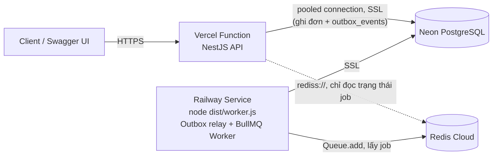

# 08 — Triển khai

## 1. Các môi trường

| Môi trường | API | Worker | PostgreSQL | Redis |
|---|---|---|---|---|
| Local | `npm run start:dev` (cổng 3000) | `npm run start:worker:dev` | Docker `postgres:16-alpine` | Docker `redis:7-alpine` |
| Production | Vercel (serverless) | Railway (tiến trình chạy lâu dài) | Neon | Redis Cloud (free) |

## 2. Chạy local

### 2.1 Yêu cầu

Node.js 22 LTS (≥ 22.13, khuyến nghị ≥ 22.22.3), npm, Docker Desktop.

`engines.node` (`^22.13`, tức ≥ 22.13 và < 23) có hai vai trò: mức tối thiểu để **chạy** app (TypeORM 1.x cần `^22.13`, các gói `@nestjs/*` 12 cần `require(esm)`), và major mà Vercel/Railway dùng khi deploy (§4.1, [ADR-029](10-technical-decisions.md#adr-029-phiên-bản-thư-viện)). Mọi dependency production đều chấp nhận mức này. Riêng các gói dev-only của Nest CLI (`@nestjs/schematics`, `@angular-devkit/core`, `@angular-devkit/schematics`, `@angular-devkit/schematics-cli`) khai báo `node: ^22.22.3 || ^24.15.0 || >=26.0.0`. Vì vậy trên Node 22.13–22.22, `npm ci` in cảnh báo `npm warn EBADENGINE Unsupported engine` cho các gói này. Cảnh báo vô hại (npm không bật `engine-strict`): `npm run build`, `npm test` và `npm run lint` vẫn chạy bình thường, đã kiểm tra trên Node 22.19. Dùng Node ≥ 22.22.3 khi phát triển local để không còn cảnh báo. Node 24 vẫn chạy được app, nhưng `npm ci` in cảnh báo `EBADENGINE` cho chính dự án, vì `engines.node` giới hạn ở major 22.

### 2.2 `docker-compose.yml`

```yaml
services:
  postgres:
    image: postgres:16-alpine
    container_name: mini-oms-postgres
    environment:
      POSTGRES_USER: postgres
      POSTGRES_PASSWORD: postgres
      POSTGRES_DB: mini_oms
    ports:
      - "5432:5432"
    volumes:
      - pgdata:/var/lib/postgresql/data
      # Scripts in this folder run once, when the data volume is first created
      - ./docker/postgres/init:/docker-entrypoint-initdb.d:ro
    healthcheck:
      test: ["CMD-SHELL", "pg_isready -U postgres -d mini_oms"]
      interval: 5s
      timeout: 3s
      retries: 10

  redis:
    image: redis:7-alpine
    container_name: mini-oms-redis
    # BullMQ requires noeviction: Redis must never evict job keys
    command: ["redis-server", "--appendonly", "yes", "--maxmemory-policy", "noeviction"]
    ports:
      - "6379:6379"
    volumes:
      - redisdata:/data
    healthcheck:
      test: ["CMD", "redis-cli", "ping"]
      interval: 5s
      timeout: 3s
      retries: 10

volumes:
  pgdata:
  redisdata:
```

> DB `mini_oms_test` cho integration test được tạo tự động bởi `docker/postgres/init/01-create-test-db.sql` khi volume `pgdata` được khởi tạo lần đầu. Nếu volume đã tồn tại từ trước khi có script này, `npm run test:e2e` tự tạo DB (`test/e2e/global-setup.ts`), hoặc tạo thủ công: `docker exec -it mini-oms-postgres createdb -U postgres mini_oms_test`.

### 2.3 Các bước

```powershell
# 1. Cấu hình
Copy-Item .env.example .env          # bash: cp .env.example .env

# 2. Hạ tầng
docker compose up -d

# 3. Cài đặt và migration
npm ci
npm run migration:run
npm run seed                          # tùy chọn

# 4. Chạy (2 terminal)
npm run start:dev                     # API:    http://localhost:3000, Swagger: http://localhost:3000/api/docs
npm run start:worker:dev              # Worker: xem log xử lý job
```

### 2.4 npm scripts

| Script | Lệnh | Mô tả |
|---|---|---|
| `build` | `nest build` | Biên dịch ra `dist/` (gồm `main.js`, `worker.js`, `vercel.js`, migrations) |
| `start:dev` | `nest start --watch` | API chế độ dev |
| `start:prod` | `node dist/main.js` | API production (ngoài Vercel) |
| `start:worker:dev` | `nest start --watch --entryFile worker` | Worker chế độ dev |
| `start:worker:prod` | `node dist/worker.js` | Worker production |
| `typeorm` | `typeorm-ts-node-commonjs -d src/database/data-source.ts` | Lệnh gốc cho CLI |
| `migration:generate` | `npm run typeorm -- migration:generate` | Ví dụ: `npm run migration:generate -- src/database/migrations/CreateOrders` |
| `migration:run` / `migration:revert` | `npm run typeorm -- migration:run` / `migration:revert` | Chạy / lùi migration (dev) |
| `migration:show` | `npm run typeorm -- migration:show` | Liệt kê migration đã chạy và đang chờ |
| `migration:run:prod` | `typeorm -d dist/database/data-source.js migration:run` | Chạy migration từ code đã build |
| `seed` | `ts-node src/database/seed.ts` | Dữ liệu mẫu |
| `job:expire-now` | `ts-node src/scripts/expire-now.ts` | Gọi `expireStaleOrders()` một lần, dùng cho MT-09. Script dùng `AppModule` (không có worker), chỉ cần DB. `ts-node` dùng `tsconfig.json` của dự án và chạy được trên Windows, mất khoảng 8–10s vì phải kiểm tra kiểu |
| `job:requeue` | `ts-node src/scripts/requeue-order.ts` | `npm run job:requeue -- <orderId>`: xóa job `order-<id>` rồi đẩy lại, dùng cho MT-08 |
| `race:last-item` | `ts-node src/scripts/race-last-item.ts` | `npm run race:last-item -- [baseUrl] [N]`: N đơn đồng thời cho một sản phẩm `stock = 1` trên API đang chạy, in kết quả ([06 §9](06-concurrency.md#9-kiểm-chứng)) |
| `test` / `test:cov` | `jest` | Unit test ([07 §2–4](07-testing.md)) |
| `test:e2e` | `jest --config test/jest-e2e.config.js --runInBand` | Integration/đồng thời trên Postgres và Redis của docker-compose, DB `mini_oms_test`, env `.env.test` ([07 §5](07-testing.md#5-integration-test-và-test-đồng-thời)) |

## 3. Kiến trúc production



| Thành phần | Lựa chọn | Lý do / lưu ý |
|---|---|---|
| API | **Vercel** | Theo yêu cầu đề. Không đẩy job (Outbox), không chạy worker. Chỉ đọc trạng thái job từ Redis |
| PostgreSQL | **Neon** ([ADR-024](10-technical-decisions.md#adr-024-postgresql-production)) | Free tier, có connection pooler (PgBouncer), phù hợp với serverless vì có nhiều kết nối ngắn |
| Redis | **Redis Cloud** free ([ADR-006](10-technical-decisions.md#adr-006-redis-production)) | Phải đặt `maxmemory-policy = noeviction`. Không chọn Upstash vì worker BullMQ gửi lệnh liên tục kể cả khi rảnh (blocking pop, kiểm tra stalled, scheduler), dễ vượt hạn mức lệnh của gói free |
| Worker | **Railway** ([ADR-005](10-technical-decisions.md#adr-005-nơi-chạy-worker)) | Chạy tiến trình Node lâu dài (relay outbox và BullMQ worker), deploy từ GitHub, không cần mở cổng. Phương án khác ở §5.4 |

> Chính sách free tier của các nhà cung cấp thay đổi thường xuyên. Hãy kiểm tra lại tại thời điểm deploy và ghi lựa chọn cuối cùng vào README.

## 4. Deploy API lên Vercel

### 4.1 Handler serverless

Dùng chung `configureApp()` với `main.ts`. Nest app được tạo **một lần cho mỗi instance** và tái sử dụng giữa các lần gọi khi instance còn ấm. Code thật: `src/vercel.ts` (rút gọn bên dưới), `api/index.js`, `vercel.json`, `public/.gitkeep`.

```ts
// src/vercel.ts  (nest build biên dịch thành dist/vercel.js)
let ready: Promise<RequestListener> | undefined;   // app Express bên trong Nest

async function bootstrap(): Promise<RequestListener> {
  // abortOnError: false: lỗi khởi động bị reject ở đây thay vì process.exit()
  const app = await NestFactory.create<NestExpressApplication>(AppModule, { abortOnError: false });
  try {
    configureApp(app);   // ValidationPipe, AllExceptionsFilter, Swagger
    await app.init();    // KHÔNG gọi app.listen(): Vercel giữ HTTP server
  } catch (error) {
    await app.close().catch(() => undefined);   // trả connection của app khởi động dở
    throw error;
  }
  return app.getHttpAdapter().getInstance();    // app Express: (req, res) => void
}

function getApp(): Promise<RequestListener> {
  // Request đến trong lúc khởi động cùng chờ một promise. Khởi động lỗi thì không cache lỗi:
  // request sau thử lại (ví dụ DB vừa thức dậy)
  ready ??= bootstrap().catch((error: unknown) => { ready = undefined; throw error; });
  return ready;
}

export default async function handler(req: IncomingMessage, res: ServerResponse): Promise<void> {
  let app: RequestListener;
  try {
    app = await getApp();
  } catch (error) {
    Logger.error(`API failed to start: ${errorMessage(error)}`, …, 'Vercel');
    sendStartupError(req, res);   // 503 SERVICE_UNAVAILABLE theo định dạng lỗi thống nhất
    return;
  }
  app(req, res);
}
```

Khác mẫu ban đầu: không `import express` (gói `express` chỉ là dependency gián tiếp qua `@nestjs/platform-express`), mà lấy app Express mà Nest tự tạo bằng `getHttpAdapter().getInstance()`.

```js
// api/index.js: entry của Vercel, trỏ vào code đã được tsc biên dịch
module.exports = require('../dist/vercel').default;
```

```json
// vercel.json
{
  "$schema": "https://openapi.vercel.sh/vercel.json",
  "buildCommand": "npm run build",
  "functions": {
    "api/index.js": { "includeFiles": "dist/**", "maxDuration": 30 }
  },
  "rewrites": [{ "source": "/(.*)", "destination": "/api" }]
}
```

> **Vì sao trỏ vào `dist/` (đã build bằng `tsc`)?** NestJS cần `emitDecoratorMetadata` cho dependency injection. Các bundler dựa trên esbuild không phát sinh metadata này, nên DI sẽ hỏng khi chạy. Build bằng `nest build` (tsc) rồi để function `require` lại là cách an toàn nhất. `includeFiles: "dist/**"` đưa cả entity và migration vào function, vì TypeORM nạp chúng theo glob lúc chạy nên công cụ dò file của Vercel không tự thấy.
> Vercel gần đây có hỗ trợ NestJS theo kiểu zero-config. Nếu muốn dùng, hãy đọc tài liệu Vercel hiện hành. Cách thủ công ở trên không phụ thuộc vào tính năng đó.

**Phiên bản Node.js của function:** `dist/` là CommonJS và `require()` các gói `@nestjs/*` 12 (chỉ có ES module), nên cần Node ≥ 22.12 (`require(esm)`). Vercel chọn major theo `engines.node` của `package.json`, và ưu tiên nó hơn cài đặt của project. Theo tài liệu Vercel (đọc ngày 2026-10-15: có 22.x và 24.x, mặc định 24.x), một khoảng mở như `>=22.13` được map sang **24.x mới nhất**, còn `22.x`/`^22…` map sang 22.x mới nhất. Vì vậy `engines.node` là `^22.13`: tối thiểu 22.13 (TypeORM 1.x, `require(esm)`), và production (Vercel, Railway) chạy cùng major 22 với môi trường đã build và test ([ADR-029](10-technical-decisions.md#adr-029-phiên-bản-thư-viện)). `vercel.json` không có field chọn phiên bản Node.

**Kiểm tra local (đã chạy, không cần tài khoản Vercel):**

1. `npm run build`, rồi `node -e "require('./api/index.js')"`: nạp được và thoát ngay (chỉ nạp module, chưa khởi động app).
2. Một harness nhỏ tạo `http.createServer((req, res) => handler(req, res))` rồi gọi thử. Kết quả trên Node 22.19 với Postgres/Redis của docker-compose: lần gọi đầu khởi động app khoảng 1.2s (hai request đồng thời cùng chờ một lần khởi động). `/api/docs` `200` HTML tham chiếu asset Swagger UI 5.29.1 trên cdnjs, `/api/docs-json` `200` đủ các path (kể cả `/health`), `/health` `200` `ok`, `/products` `200`, `/products/abc` `400 VALIDATION_ERROR`, đường dẫn lạ `404 NOT_FOUND`.
3. Với `DATABASE_URL` trỏ vào cổng không có Postgres: TypeORM thử kết nối lại 10 lần cách nhau 3s, rồi handler trả `503` theo định dạng lỗi thống nhất. Request sau chạy lại toàn bộ bước khởi động (lỗi không bị cache).
4. `node dist/main.js` vẫn chạy như trước (`src/main.ts` không đổi).

### 4.2 Các bước

1. Import GitHub repo vào Vercel, chọn Framework Preset là **Other**. Build Command và cấu hình function lấy từ `vercel.json`. Phiên bản Node lấy từ `engines.node` (`^22.13`, tức 22.x), không cần chọn trong Project Settings.
2. Khai báo Environment Variables: `NODE_ENV=production`, `DATABASE_URL` (**pooled** connection string của Neon), `DATABASE_SSL=true`, `DATABASE_POOL_MAX=3`, `REDIS_URL` (`rediss://…`, chỉ để đọc trạng thái job), `DB_LOCK_TIMEOUT_MS`, `SWAGGER_ENABLED=true`. Các biến `JOB_*` và `OUTBOX_*` chỉ cần ở worker.
3. Chạy migration lên DB production **trước** khi deploy (§6).
4. Deploy, rồi mở `https://<project>.vercel.app/api/docs` và `/health` (§7).

### 4.3 Lưu ý khi chạy NestJS trên Vercel

| Vấn đề | Cách xử lý |
|---|---|
| Swagger UI trắng trang vì không tải được asset tĩnh | Lấy asset từ CDN (khóa phiên bản cố định có trên cdnjs): `SwaggerModule.setup('api/docs', app, document, { customCssUrl: 'https://cdnjs.cloudflare.com/ajax/libs/swagger-ui/<ver>/swagger-ui.min.css', customJs: ['…/swagger-ui-bundle.min.js', '…/swagger-ui-standalone-preset.min.js'] })`. Code dùng `5.29.1` (bản mới nhất có trên cdnjs lúc code, `swagger-ui-dist` đi kèm `@nestjs/swagger` là 5.33 nhưng chưa có trên cdnjs). HTML của Nest vẫn tham chiếu asset cục bộ trước rồi mới tới thẻ CDN; `swagger-ui-init.js` chỉ chạy ở `window.onload`, nên bản CDN luôn là bản được dùng, kể cả khi asset cục bộ trả 404 trên Vercel |
| Hết connection Postgres vì mỗi instance mở một pool | Dùng pooled URL của Neon, `DATABASE_POOL_MAX` nhỏ (2–3) |
| Cold start chậm | Cache app (`ready ??= bootstrap()`), không chạy migration lúc khởi động, giữ `AppModule` gọn (không import processor). Swagger document chỉ được dựng khi `/api/docs` được gọi lần đầu |
| Khởi động lỗi (DB chưa sẵn sàng) | TypeORM thử kết nối lại 10 lần cách nhau 3s (khoảng 27s, vẫn trong `maxDuration` 30s), rồi handler trả `503 SERVICE_UNAVAILABLE` theo định dạng thống nhất. Promise lỗi không được cache, request sau khởi động lại. App khởi động dở được `close()` để trả connection |
| Env sai (thiếu `DATABASE_URL`, giá trị không hợp lệ) | `ConfigModule` validate ngay khi nạp `AppModule`, nên function lỗi lúc nạp module và log liệt kê mọi biến sai, giống `main.ts` dừng ngay. Đây là lỗi cấu hình chứ không phải lỗi tạm thời, nên không bị đổi thành `503` |
| Function chạy Node 24 thay vì 22 | `engines.node` là `^22.13` (§4.1). Một khoảng mở như `>=22.13` sẽ được Vercel map sang 24.x |
| Worker vô tình chạy trong function | `AppModule` không import `WorkerModule` hay bất kỳ `@Processor` nào |
| Request treo khi Redis không truy cập được | `POST /orders` không dùng Redis (Outbox). `GET /orders/:id/jobs` dùng `enableOfflineQueue: false` để trả `503` ngay |
| Vercel báo thiếu thư mục output (`public`) | Tạo thư mục `public/` rỗng (có `.gitkeep`) hoặc cấu hình `outputDirectory` |

## 5. Deploy worker

### 5.1 Vì sao không chạy worker trên Vercel/Netlify

1. **Vòng đời function gắn với request.** Function chỉ chạy trong lúc xử lý request, sau khi trả response thì bị đóng băng hoặc thu hồi. BullMQ `Worker` cần một vòng lặp chạy liên tục, giữ kết nối Redis ở chế độ blocking để chờ job.
2. **Gia hạn khóa job.** Worker phải gia hạn lock của job định kỳ. Khi function bị đóng băng, lock hết hạn, job bị coi là stalled và bị xử lý lại.
3. **Job trễ và job lặp lại.** Backoff (2s, 4s, 8s) và scheduler 5 phút cần một tiến trình đang chạy để đưa job đến hạn vào hàng đợi đúng lúc.
4. **Relay outbox** phải quét liên tục (khoảng mỗi giây). Function serverless không có vòng lặp nền.
5. **Giới hạn thời gian chạy và số instance.** Mỗi job mất 3–5 giây cộng thêm retry. Các instance tự co giãn có thể bị hủy giữa lúc đang xử lý job.

Vì vậy API (serverless) chỉ ghi đơn kèm sự kiện outbox vào DB. **Relay và consumer** chạy trong một tiến trình riêng, lâu dài.

### 5.2 So sánh phương án

| Phương án | Mô tả | Ưu | Nhược | Chọn |
|---|---|---|---|---|
| **A. Worker riêng (Railway/Render/Fly.io)** | `node dist/worker.js` chạy liên tục | Đúng mô hình BullMQ: retry, backoff, scheduler, kiểm tra stalled đều hoạt động. Relay outbox chạy liên tục. Độ trễ thấp. Dùng chung codebase | Thêm một dịch vụ cần vận hành, có thể tốn phí | ✅ |
| B. Cron gọi endpoint serverless | Cron (Vercel Cron, cron-job.org, GitHub Actions) gọi `POST /internal/jobs/run`, endpoint xử lý job theo lô trong giới hạn thời gian | Không cần thêm dịch vụ | Độ trễ phụ thuộc chu kỳ cron (gói Hobby của Vercel giới hạn tần suất cron). Backoff không đúng giờ. Phải tự xử lý job bằng tay (`getNextJob`, gia hạn lock). Bị giới hạn thời gian chạy của function. Cần bảo vệ endpoint bằng secret | ✗ |
| C. Worker chạy trong function Vercel | Khởi tạo `Worker` trong app serverless | — | Không hoạt động đúng (§5.1) | ✗ |

### 5.3 Railway: các bước

1. **New Project → Deploy from GitHub repo**, chọn repo này.
2. **Build:** `npm ci && npm run build` (Railway tự nhận diện Node và chọn phiên bản theo `engines.node`, tức 22.x).
3. **Start command:** `npm run start:worker:prod` (= `node dist/worker.js`).
4. **Pre-deploy command** *(khuyến nghị)*: `npm run migration:run:prod`. Migration chạy ở **một nơi duy nhất**, trước mỗi lần deploy.
5. **Variables:** `NODE_ENV=production`, `DATABASE_URL` (Neon), `DATABASE_SSL=true`, `DATABASE_POOL_MAX=5`, `REDIS_URL`, `JOB_ATTEMPTS=4`, `JOB_BACKOFF_DELAY_MS=2000`, `JOB_KEEP_COMPLETED_SECONDS`, `JOB_KEEP_FAILED_SECONDS`, `OUTBOX_POLL_INTERVAL_MS=1000`, `OUTBOX_BATCH_SIZE=50`, `OUTBOX_MAX_BACKOFF_MS=30000`, `JOB_PROCESSING_MIN_MS`, `JOB_PROCESSING_MAX_MS`, `JOB_FAILURE_RATE=0.3`, `WORKER_CONCURRENCY=5`, `ORDER_PENDING_TTL_MINUTES=30`, `EXPIRE_PENDING_EVERY_MS=300000`, `EXPIRE_BATCH_SIZE=100`.
6. **Networking:** không cần public domain vì worker không nhận HTTP.
7. **Replicas:** 1. **Restart policy:** On failure. (Scale lên nhiều replica vẫn an toàn nhờ `SKIP LOCKED` và lock job của BullMQ.)
8. **Kiểm tra log:** thấy `Worker started on queue order-processing (concurrency 5)`, `Outbox relay started (poll every 1000 ms, batch of 50)` và `Job scheduler expire-pending-orders upserted`.

`src/worker.ts` (rút gọn):

```ts
async function bootstrap(): Promise<void> {
  // abortOnError: false để lỗi khởi động rơi vào catch bên dưới
  const app = await NestFactory.createApplicationContext(WorkerModule, { abortOnError: false });
  app.enableShutdownHooks();   // SIGTERM/SIGINT: dừng relay outbox, worker.close() chờ job đang chạy xong
  exitIfShutdownHangs('Worker'); // quá 10s mà chưa tắt xong (ví dụ Redis đang tắt) thì exit(1); main.ts cũng gọi hàm này
  Logger.log('Worker started', 'Worker');
}

bootstrap().catch((error: unknown) => {
  Logger.error(`Worker failed to start: ${errorMessage(error)}`, error instanceof Error ? error.stack : undefined, 'Worker');
  process.exit(1);             // Railway (restart policy On failure) khởi động lại
});
```

> Grace period giữa SIGTERM và SIGKILL của nền tảng nên ≥ 10s (Docker mặc định 10s), để job đang chạy kịp xong.
> `npm run start:dev` và `npm run start:worker:dev` cùng biên dịch vào `dist/`. Hãy chạy lần lượt (đợi lệnh thứ nhất in `Found 0 errors`), vì `deleteOutDir` xóa `dist/` khi mỗi lệnh bắt đầu.

### 5.4 Phương án thay thế

| Nền tảng | Cách làm | Lưu ý |
|---|---|---|
| Render | Dịch vụ loại **Background Worker**, start command `node dist/worker.js` | Background Worker là gói trả phí. Web Service free sẽ ngủ khi không có traffic nên không hợp để làm worker |
| Fly.io | Dockerfile kèm `fly.toml` không có `[http_service]`, process `node dist/worker.js` | Tính phí theo mức dùng, máy nhỏ chi phí thấp |

## 6. Migration trên production

- **Không bao giờ** dùng `synchronize`, và **không** chạy migration khi Vercel cold start.
- Cách 1 (khuyến nghị): Pre-deploy command của Railway, `npm run migration:run:prod`.
- Cách 2: chạy từ máy local, trỏ vào DB production (nên dùng **direct** connection string của Neon, không qua pooler). CLI validate env giống lúc app khởi động, nên các biến bắt buộc khác (ví dụ `REDIS_URL`) vẫn phải hợp lệ, lấy từ `.env` local là đủ:
  ```powershell
  $env:DATABASE_URL = "postgres://<user>:<pass>@<host>/<db>?sslmode=require"
  $env:DATABASE_SSL = "true"
  npm run migration:run
  ```
- Thứ tự an toàn khi thay đổi schema: **migration → worker → API**. Migration phải tương thích ngược với code cũ.

## 7. Smoke test sau khi deploy

```bash
BASE=https://<project>.vercel.app

curl -s "$BASE/health"
curl -s -X POST "$BASE/products" -H 'content-type: application/json' \
  -d '{"sku":"DEMO-001","name":"Demo product","price":100000,"stock":5}'
curl -s -X POST "$BASE/orders" -H 'content-type: application/json' \
  -d '{"customerName":"Demo","customerEmail":"demo@example.com","items":[{"productId":"<productId>","quantity":1}]}'
# chờ khoảng 8 giây
curl -s "$BASE/orders/<orderId>"        # CONFIRMED (hoặc vẫn PENDING nếu đang retry)
curl -s "$BASE/orders/<orderId>/jobs"   # state, attemptsMade, failedReason
```

## 8. Checklist triển khai

- [ ] `.env` không bị commit, `.env.example` đầy đủ biến
- [ ] Redis production đặt `maxmemory-policy noeviction` và dùng TLS (`rediss://`)
- [ ] Đã chạy migration trên DB production (`SELECT * FROM migrations` thấy đủ các bản ghi)
- [ ] API trên Vercel: `/api/docs` hiển thị, `/health` trả `ok`
- [ ] Worker trên Railway: log báo đã khởi động, đơn test chuyển sang `CONFIRMED`
- [ ] Job scheduler `expire-pending-orders` tồn tại (xem log worker)
- [ ] Không có sự kiện outbox tồn đọng: `SELECT count(*) FROM outbox_events WHERE published_at IS NULL` xấp xỉ 0
- [ ] README có link API, link Swagger, lý do chọn Railway cho worker
